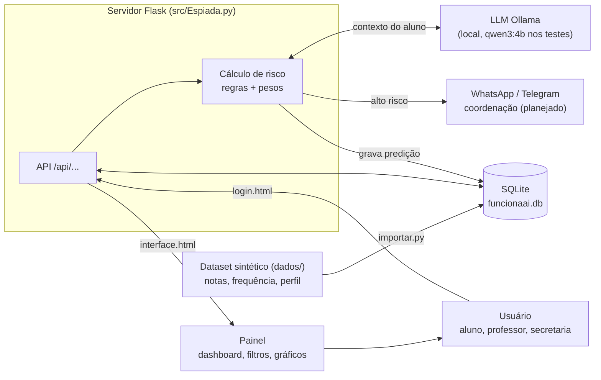
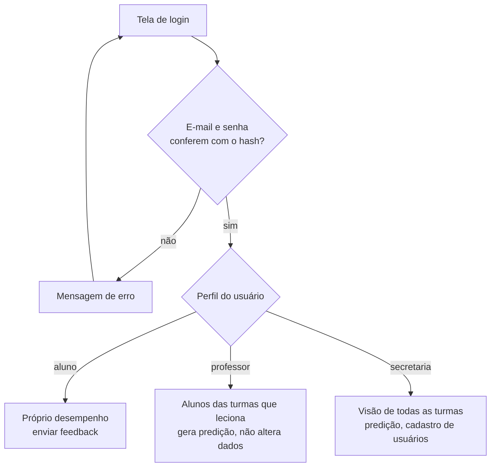
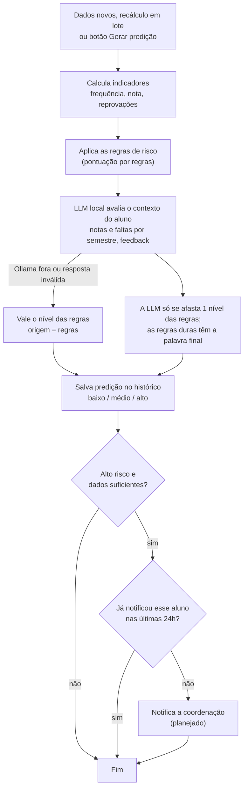
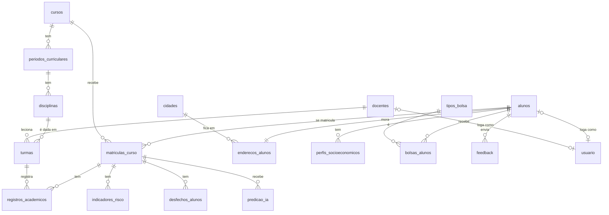

# Espiada: Sistema de Monitoramento e Predição de Risco de Evasão Acadêmica (SIMPA)

Projeto do curso de Inteligência Artificial da Universidade Evangélica de Goiás (UniEVANGÉLICA), Anápolis, Goiás.

O Espiada é um sistema web que acompanha o desempenho dos alunos e aponta quem corre risco de evadir. Ele reúne notas, frequência e perfil de cada aluno num único banco, calcula um nível de risco (baixo, médio ou alto) e mostra num painel os alunos que precisam de atenção, para que a coordenação e os professores possam agir antes da evasão acontecer. Cada perfil de acesso enxerga só os alunos que pode ver.

## Autores

- Diego Garcez: full stack e documentação
- André Ribeiro: banco de dados

## O que o sistema faz

- **Importação dos dados acadêmicos:** notas, frequência, endereço e perfil socioeconômico entram no banco só pelo importador (`src/importar.py`), a partir de um dataset sintético com 120 alunos de Engenharia de Software (2023-1 a 2026-2). Nenhum registro é de uma pessoa real, e nenhuma tela permite editar nota ou frequência.
- **Painel geral:** cards com o total de alunos e quantos estão em risco alto, médio e baixo, a lista dos alunos em risco crítico e quatro tipos de gráfico: barras (% de alto risco por turma), barras empilhadas (alto, médio e baixo por turma), rosca (distribuição geral) e radar (alunos com risco por turma). O filtro por turma vale para o painel inteiro. Os gráficos são desenhados à mão em CSS e SVG, sem biblioteca.
- **Monitoramento:** tabela com todos os alunos visíveis, com turma, frequência, nota, reprovações e risco. Tem busca por nome e filtros por turma e por nível de risco. Clicar no aluno abre a ficha dele.
- **Ficha do aluno:** notas e frequência de cada disciplina, separadas por semestre, e o histórico de predições de risco.
- **Predição de risco:** o professor ou a secretaria escolhe um aluno e gera a classificação. O sistema soma pontos por regras, pede a opinião de uma LLM local e mostra o nível final, os fatores que pesaram, o comentário da LLM e os ajustes feitos pelas regras duras. A seção [Como o risco é calculado](#como-o-risco-é-calculado) explica cada passo.
- **Recálculo em lote:** a secretaria pode recalcular a predição de todos os alunos de uma vez, em segundo plano. Quem não mudou desde a última análise é pulado.
- **Histórico que não se perde:** cada predição vira uma linha nova no banco. Nada é sobrescrito, então dá para ver como o risco de um aluno mudou ao longo do tempo.
- **Perfis de acesso:** o aluno vê só o próprio desempenho; o professor vê só os alunos que passaram pelas turmas dele; a secretaria vê todos e cadastra usuários. Qualquer tentativa fora disso é negada e registrada no log.
- **Feedback do aluno:** o aluno avalia o curso ou a instituição. A rota que grava o feedback já funciona, mas o formulário da tela ainda é só demonstração e não envia nada.

## Como o risco é calculado

O cálculo tem três camadas: uma pontuação por regras, uma opinião da LLM e as regras duras, que têm a palavra final. A pontuação e os fatores mostram **por que** o sistema apontou risco; a LLM é uma análise complementar.

**Pontuação por regras.** Cada sinal de alerta soma pontos: frequência média abaixo de 75% (+2), nota média abaixo de 60 (+2), reprovação no histórico (+1), reclamação no feedback, ou seja, avaliação 1 ou 2 (+1), e morar a mais de 30 km do campus (+1). Com 4 pontos ou mais o risco é alto, com 2 ou 3 é médio, e abaixo disso é baixo. Um indicador sem dado, como o de um aluno ainda sem notas, não soma ponto. Os pesos estão na lista `REGRAS` de `src/models/predicao.py`.

**Opinião da LLM.** A LLM recebe os indicadores do aluno, o resumo de cada semestre (nota média, frequência média e reprovações), os três últimos comentários dele e a pré-análise das regras. Com isso ela enxerga o que as médias escondem: a tendência entre os semestres e o tom dos comentários. Ela devolve um nível e um comentário curto, num JSON com formato obrigatório. Não é um chat: o prompt é fixo e ninguém digita nada para ela. O comentário do aluno entra como dado, e o prompt manda ignorar qualquer ordem escrita nele.

**Limite da LLM.** A LLM pode mudar o nível das regras em no máximo um degrau (`LLM_PASSO_MAXIMO`). Se as regras dizem "baixo", ela pode chegar no máximo a "médio".

**Regras duras.** Valem por cima da pontuação e da LLM:

- frequência abaixo de 75% deixa o risco em **alto**;
- menos de 8 registros acadêmicos (`HISTORICO_MINIMO`) limitam o risco a **médio**, porque ainda não há dados suficientes para cravar "alto";
- quando as duas valem ao mesmo tempo, o histórico curto vence e o risco fica **médio**.

**Sem a LLM.** Se o Ollama estiver fora do ar ou a resposta vier fora do formato, a predição sai só com as regras, fica marcada com `origem = regras` e a tela mostra o aviso com o motivo. O sistema nunca deixa de funcionar por causa da LLM.

### A LLM

**Nos nossos testes locais usamos o `qwen3:4b`** (4 bilhões de parâmetros), rodando na própria máquina pelo [Ollama](https://ollama.com). Nenhum dado vai para a nuvem.

A escolha do modelo muda pouco a predição, desde que ele tenha **pelo menos 2 bilhões de parâmetros**. O motivo está no próprio desenho: a LLM só pode mover o nível das regras em um degrau, e as regras duras valem por cima dela. Para usar outro modelo, basta definir a variável de ambiente `OLLAMA_MODEL` antes de subir o servidor (por exemplo, no PowerShell, `$env:OLLAMA_MODEL = "qwen3:4b"`).

O `qwen3:4b` foi usado **só em testes locais**. Os dados enviados a ele **não passaram por tratamento de acordo com a LGPD**: o sistema não manda nome, matrícula nem endereço, mas isso não foi avaliado como anonimização nos termos da lei.

A temperatura é 0 e a semente é fixa, então a mesma entrada dá a mesma resposta. O modelo fica carregado na memória por 30 minutos depois de cada uso; a primeira chamada é a mais lenta, porque carrega o modelo. As outras variáveis opcionais são `OLLAMA_URL` (padrão `http://localhost:11434`) e `OLLAMA_TIMEOUT` (padrão 120 segundos).

**Recálculo em lote.** Pelo terminal, `flask --app src/Espiada.py recalcular-predicoes` analisa todos os alunos (`--forcar` reanalisa também quem não mudou). Pela API, a secretaria usa `POST /api/predicoes/recalcular` e acompanha o andamento em `GET /api/predicoes/recalculo`. Para saber quem mudou, o sistema guarda a cada análise um resumo (hash) do que a LLM recebeu, junto com o modelo e a versão do prompt; se o resumo for igual ao da última análise, o aluno é pulado. Antes de começar, o sistema confere se o Ollama responde, e se a LLM falhar três vezes seguidas, o lote para.

## Tecnologias

Python 3.10+, Flask, Werkzeug (hash de senha e erros HTTP), Click (comandos de terminal), SQLite, Ollama com o cliente `ollama` para Python e HTML, CSS e JavaScript puro nas telas. A fonte Inter é servida pelo próprio sistema. A arquitetura é MVC: os models guardam os dados e as regras, as views são as telas e os controllers recebem os pedidos, conferem login e perfil e devolvem JSON.

## Como executar

1. Baixe o código (botão **Code** e depois **Download ZIP**) e extraia em uma pasta. Se preferir, clone o repositório com o git:

   ```
   git clone https://github.com/DiegoGDutra/Projeto-Espiada
   ```

2. Abra o terminal na pasta do projeto, a que contém o `requirements.txt`.
3. Instale as dependências:

   ```
   pip install -r requirements.txt
   ```

   No Windows, se o comando `pip` não for reconhecido, use `py -m pip install -r requirements.txt`. Se quiser, crie antes um ambiente virtual com `python -m venv .venv`.

4. Importe o dataset para o banco (só na primeira vez; já cria os logins padrão):

   ```
   python src/importar.py
   ```

5. (Opcional, para a predição com LLM) Instale o [Ollama](https://ollama.com/download) e baixe o modelo uma vez:

   ```
   ollama pull qwen3:4b
   ```

   O Ollama precisa estar aberto quando você gerar uma predição. Sem ele, a predição sai só com as regras.

6. Inicie o servidor:

   ```
   python src/Espiada.py
   ```

   No Windows, também pode ser `py src/Espiada.py`.

7. Abra no navegador:

   ```
   http://127.0.0.1:5000
   ```

O banco de dados `src/funcionaai.db` (SQLite) é criado automaticamente quando o servidor sobe, e as colunas novas são acrescentadas sozinhas em bancos antigos. Para recriar o banco do zero, apague esse arquivo e rode o importador de novo. Para conferir o sistema, rode `python src/teste_banco.py`, `python src/teste_api.py` e `python src/teste_llm.py`; nenhum dos três precisa do Ollama.

## Acesso ao sistema

O importador cria um login de cada perfil:

- Secretaria: `secretaria@simpa.test`, senha `Secretaria#2026` (vê os 120 alunos)
- Professor: `professor@simpa.test`, senha `Professor#2026` (vê os 78 alunos que passaram pelas turmas dele)
- Aluno: `aluno@simpa.test`, senha `Aluno#2026` (Estudante Sintético 001, matrícula `AES0001`)

Essas senhas existem apenas para facilitar os testes e devem ser trocadas em qualquer uso real. Outros usuários são cadastrados pelo terminal, com `flask --app src/Espiada.py criar-usuario fulano@exemplo.com professor "Fulano" --vinculo 2`, ou pela rota `POST /api/usuarios`; a tela de cadastro na aba Config. ainda está em desenvolvimento.

A senha precisa ter 8 ou mais caracteres, com maiúscula, minúscula, número e caractere especial, e fica guardada no banco apenas como hash. Depois de 5 senhas erradas seguidas, o login fica bloqueado por 15 minutos. A sessão fica num cookie assinado e protegido (`HttpOnly`, `SameSite=Strict`). Em uso real, defina a variável de ambiente `SECRET_KEY`; sem ela, o servidor gera uma chave nova a cada vez que sobe e todo mundo precisa entrar de novo.

## Privacidade e LGPD

O Espiada trata dados acadêmicos e socioeconômicos de alunos, protegidos pela Lei nº 13.709/2018 (LGPD). Por isso o sistema tem a página `/sobre.html`, acessível sem login pelo rodapé de qualquer tela, com as abas Termos de Uso, Privacidade (LGPD), Cookies e Contato.

A política de privacidade descreve os dados coletados, a finalidade, a base legal, as decisões automatizadas (o aluno pode pedir revisão da classificação de risco e saber quais critérios foram usados), o armazenamento e os direitos do titular (artigo 18 da LGPD). Cada perfil recebe só os dados dos alunos que pode ver, e a LLM roda local, sem mandar nada para a nuvem. Os dados enviados à LLM ainda **não passaram por tratamento de acordo com a LGPD** (veja [A LLM](#a-llm)).

## Termos de uso e créditos

A mesma página `/sobre.html` tem as abas Sobre e Equipe, com a ficha técnica do projeto e os autores. Os Termos de Uso deixam claro que o nível de risco é um **apoio à decisão**, não uma conclusão sobre o aluno, e que qualquer ação deve ser avaliada por uma pessoa.

O código e o conteúdo do Espiada pertencem aos autores. Os componentes de terceiros seguem as próprias licenças: a fonte Inter, sob a SIL Open Font License 1.1 (`src/static/fontes/OFL.txt`), e o Flask, sob a licença BSD-3-Clause.

## Estrutura do projeto

```
Projeto-Espiada/
├── requirements.txt                 # dependências
├── roadmap.md                       # andamento de cada funcionalidade
├── dados/                           # dataset sintético em CSV e o dicionário das colunas
└── src/
    ├── Espiada.py                   # ponto de entrada: cria o app, registra os controllers, trata erros
    ├── importar.py                  # carrega o dataset no banco e cria os logins padrão
    ├── schema.sql                   # tabelas e regras do banco
    ├── teste_banco.py               # testes das regras do banco
    ├── teste_api.py                 # testes das rotas e permissões
    ├── teste_llm.py                 # testes da LLM com um Ollama simulado
    ├── models/                      # M: dados e regras de negócio
    │   ├── banco.py                 # conexão SQLite, transações e erros
    │   ├── usuario.py               # cadastro e autenticação
    │   ├── academico.py             # cursos, disciplinas, docentes e turmas
    │   ├── alunos.py                # resumo com indicadores, ficha e quem pode ver quem
    │   ├── predicao.py              # regras, regras duras, decisão final, recálculo e histórico
    │   ├── llm.py                   # cliente do Ollama: prompt fixo e resposta validada
    │   └── feedback.py              # comentários do aluno
    ├── controllers/                 # C: rotas HTTP
    │   ├── comum.py                 # leitura de JSON e checagem de perfil
    │   ├── auth.py                  # login, logout, sessão, cadastro e comando criar-usuario
    │   ├── paginas.py               # entrega as telas
    │   ├── academico.py             # cursos, disciplinas, docentes e turmas
    │   ├── alunos.py                # lista, ficha, feedback e predição
    │   └── predicoes.py             # recálculo em lote e comando recalcular-predicoes
    ├── views/                       # V: telas
    │   ├── login.html               # login
    │   ├── interface.html           # painel, monitoramento, predições e meu desempenho
    │   └── sobre.html               # sobre, equipe, termos, privacidade, cookies e contato
    └── static/fontes/               # fonte Inter e licença
```

Uma requisição sempre faz o mesmo caminho: a tela chama a API, o controller confere login e perfil, o model consulta ou grava no banco e aplica a regra, o controller devolve JSON e a tela desenha o resultado.

## Fluxo do sistema

### Visão geral

Os dados acadêmicos vêm do dataset sintético, importado por `src/importar.py` (ninguém edita nota ou frequência à mão). O servidor guarda tudo no SQLite, calcula o risco de cada aluno, pede para a LLM local avaliar o contexto e mostra o resultado no painel conforme o perfil de quem entrou. O aviso à coordenação por WhatsApp ou Telegram ainda é planejado.



### Login e perfis

Cada perfil vê só o que pode.



### Predição de risco

Roda quando alguém clica em **Gerar predição** (um aluno) e no **recálculo em lote**, que pula quem não mudou desde a última análise da LLM. Cada predição vira uma linha nova em `predicao_ia`, então o histórico do aluno nunca se perde. Os detalhes de cada passo estão em [Como o risco é calculado](#como-o-risco-é-calculado).



## Banco de dados e API

O banco tem 18 tabelas, criadas a partir de `src/schema.sql`. As regras de validação ficam no próprio banco: nota e frequência, por exemplo, só aceitam valores de 0 a 100. As tabelas formam quatro grupos:

- **Estrutura acadêmica:** `cursos`, `periodos_curriculares`, `disciplinas`, `turmas` e `docentes`. A turma liga uma disciplina e um docente num semestre.
- **O aluno:** `alunos` (o `codigo_academico`, como `AES0001`, é a matrícula), `matriculas_curso`, `registros_academicos` (notas e frequência por turma e tentativa), `enderecos_alunos`, `cidades`, `perfis_socioeconomicos`, `tipos_bolsa` e `bolsas_alunos`.
- **Avaliação:** `indicadores_risco` traz um risco já calculado pelo dataset e **não** entra na predição, porque seria copiar a resposta; `desfechos_alunos` diz quem de fato evadiu em 12 meses e serve só para medir se a predição acerta.
- **Do sistema:** `usuario`, `feedback` e `predicao_ia`, o histórico de predições com o nível, a origem (`llm` ou `regras`), o modelo e os detalhes do cálculo.



Na ponta de cada ligação, `||` quer dizer exatamente um, `o|` zero ou um e `o{` zero ou muitos. Por exemplo, `cursos ||--o{ periodos_curriculares` diz que um curso tem zero ou muitos períodos e cada período pertence a exatamente um curso. As relações de muitos para muitos passam por uma tabela intermediária: alunos e cursos por `matriculas_curso`, alunos e bolsas por `bolsas_alunos`, matrículas e turmas por `registros_academicos`.

A API fica toda em `/api/...`, usa JSON na entrada e na saída e exige login em todas as rotas, menos `POST /api/login`. Os erros vêm sempre como `{"erro": "..."}`, com o status HTTP correspondente (400 dado inválido, 401 sem login, 403 sem permissão, 404 não encontrado, 409 já existe, 429 login bloqueado, 503 Ollama fora no recálculo). As rotas são:

- **Sessão e usuários:** `POST /api/login`, `POST /api/logout`, `GET /api/sessao` e `POST /api/usuarios` (só secretaria).
- **Estrutura acadêmica:** `GET /api/cursos`, `/api/disciplinas`, `/api/docentes` e `/api/turmas`.
- **Alunos:** `GET /api/alunos` (lista com indicadores e risco atual), `GET /api/alunos/{matricula}` (ficha com as disciplinas) e `POST /api/alunos/{matricula}/feedback` (só o próprio aluno).
- **Predições:** `POST /api/alunos/{matricula}/predicao` gera e grava uma predição, e `GET` na mesma rota devolve o histórico; `POST /api/predicoes/recalcular` e `GET /api/predicoes/recalculo` cuidam do recálculo em lote (só secretaria).

## Limitações conhecidas

**A LLM ainda não foi comparada com o gabarito.** Ninguém mediu se as predições com LLM acertam mais do que só as regras. A tabela `desfechos_alunos` permite fazer essa conta. Nas regras atuais, 9 das 20 evasões do dataset estão em alunos classificados como risco baixo, e é aí que a LLM pode ajudar.

**Dados da LLM sem tratamento de LGPD.** A LLM foi usada só em testes locais com o `qwen3:4b`. O contexto enviado não leva nome, matrícula nem endereço, mas não passou por um tratamento de dados de acordo com a lei.

**Histórico mínimo provisório.** O corte de 8 registros para permitir risco alto é uma escolha provisória. No dataset, qualquer valor de 6 a 10 pega os mesmos 15 alunos do 1º semestre.

**Dados que o dataset não tem.** Entrega de atividades não existe no dataset, então não entra no cálculo. Como cada período tem uma única turma de 15 alunos, turma, período e ano de ingresso dão o mesmo agrupamento.

**Feedback só de demonstração.** O formulário do aluno mostra a confirmação na tela, mas não chama a API nem grava no banco.

**Recálculo em memória.** O andamento do recálculo em lote fica na memória do servidor: reiniciar o servidor o zera, e o modo de desenvolvimento do Flask pode interromper o lote ao recarregar o código.

**Uso local.** O servidor roda no modo de desenvolvimento do Flask, sem HTTPS, o que serve para teste, não para produção. O Ollama não tem autenticação: se `OLLAMA_URL` apontar para outra máquina, use só em rede confiável, porque os dados viajam sem criptografia.

## Próximos passos

- Comparar as predições com `desfechos_alunos` para saber se a LLM melhora o acerto e ajustar o prompt.
- Tratar os dados enviados à LLM de acordo com a LGPD.
- Deixar os pesos das regras configuráveis, com rota e tela.
- Ligar o formulário de feedback à API e mostrar os feedbacks para o professor.
- Avisar a coordenação sobre alunos em alto risco por WhatsApp ou Telegram.
- Exportar relatórios em PDF e CSV, por aluno, turma e curso.
- Permitir a alteração manual de uma predição, sempre com justificativa.
- Recalcular automaticamente quando chegarem dados novos e pôr um botão de recálculo na tela.
- Servir o sistema por HTTPS e testar com vários usuários ao mesmo tempo.

O andamento de cada funcionalidade está em [`roadmap.md`](roadmap.md).
