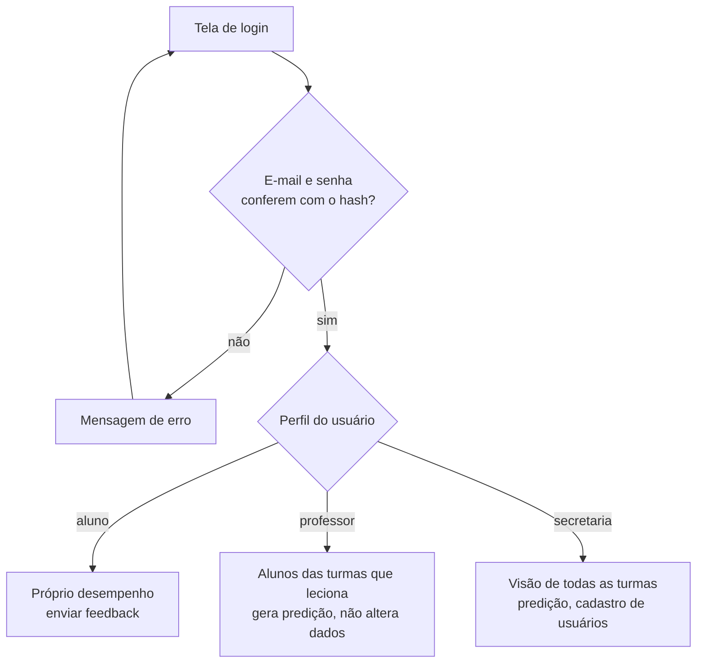
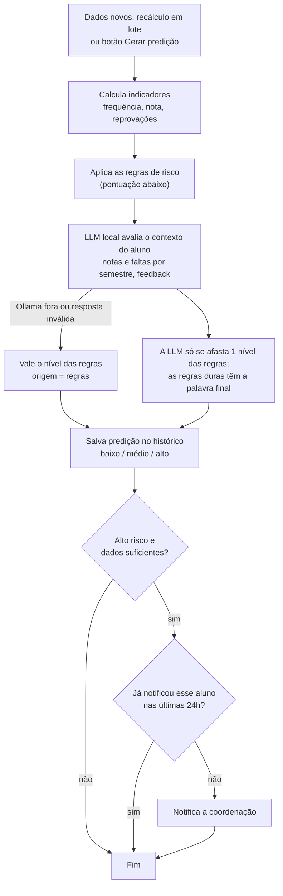
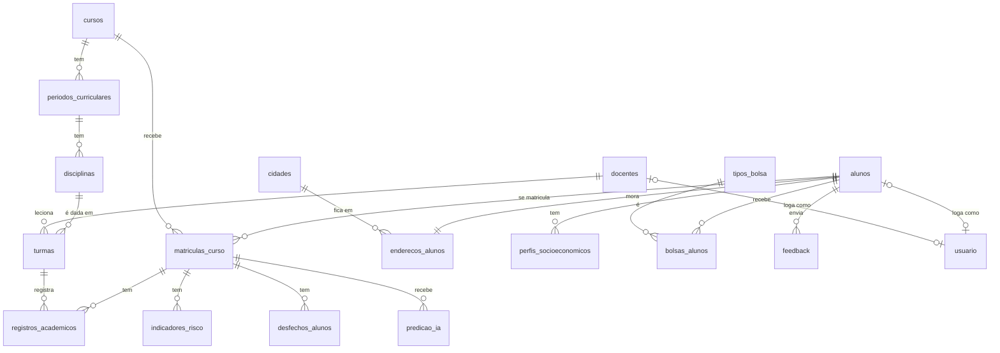

# Espiada — SIMPA

Sistema de monitoramento e predição de risco de evasão acadêmica. Flask + SQLite em arquitetura MVC; o servidor sobe por `src/Espiada.py`.

## Tecnologias

| Parte | Tecnologia |
|---|---|
| Back-end | Python 3.10+ com Flask |
| Banco de dados | SQLite (`src/funcionaai.db`), tabelas em `src/schema.sql` |
| Dados | dataset sintético (`dados/`), importado por `src/importar.py` |
| Front-end | HTML + CSS + JavaScript puro (`src/views/`), fonte Inter servida pelo próprio sistema (`src/static/`); gráficos feitos à mão em CSS e SVG, sem biblioteca |
| Predição | regras fixas + LLM **local** do Ollama (**`qwen3:4b` nos nossos testes locais**; qualquer modelo com pelo menos 2 bilhões de parâmetros serve), sem chat: o prompt é fixo e a resposta é um JSON validado. Instalação e uso em [Predição com LLM](#predição-com-llm-ollama) |

## Arquitetura (MVC)

```
src/
├── Espiada.py          ponto de entrada: cria o app, liga os controllers, trata erros
├── models/             M — dados e regras de negócio (não conhece HTTP nem tela)
│   ├── banco.py          conexão SQLite, consultar(), transacao(), ErroModelo
│   ├── usuario.py        cadastro com validação de e-mail/senha, autenticação
│   ├── academico.py      cursos, disciplinas, docentes, turmas (só leitura)
│   ├── alunos.py         resumo com indicadores, ficha, quem pode ver quem
│   ├── predicao.py       regras e cálculo do risco, regras duras, opinião da LLM, recálculo em lote, histórico
│   ├── llm.py            cliente do Ollama: prompt fixo, resposta em JSON validada, 503/502 se falhar
│   └── feedback.py       comentários do aluno
├── views/              V — telas: login.html, interface.html, sobre.html (sobre, equipe, termos, LGPD, cookies)
├── static/fontes/      arquivos do front (fonte Inter + licença)
├── controllers/        C — rotas HTTP (Blueprints do Flask)
│   ├── comum.py          ler_json(), exige() e negar() (perfil e 403 com log)
│   ├── auth.py           /api/login, /api/logout, /api/sessao, /api/usuarios, comando criar-usuario
│   ├── paginas.py        /, /interface.html, /sobre.html
│   ├── academico.py      /api/cursos, /api/disciplinas, /api/docentes, /api/turmas
│   ├── alunos.py         /api/alunos/... (lista, ficha, feedback, predição)
│   └── predicoes.py      /api/predicoes/... (recálculo em lote), comando recalcular-predicoes
├── schema.sql          tabelas e regras do banco
├── importar.py         carrega o dataset de dados/ no banco
└── teste_banco.py, teste_api.py, teste_llm.py
```

Uma requisição passa assim: a **view** (JavaScript da tela) chama a API → o **controller** confere login e perfil → o **model** consulta ou grava no banco e aplica a regra → o controller devolve JSON → a view desenha.

## Telas

| Tela | Quem vê | O que tem |
|---|---|---|
| Login (`/`) | todos | e-mail e senha; o olho do logo segue o mouse |
| **Painel geral** | professor, secretaria | cards com total e alunos em alto, médio e baixo risco; lista dos alunos em risco crítico; **filtro por turma** (vale para o painel inteiro) e **4 tipos de gráfico**: barras (% de alto risco por turma), barras empilhadas (alto, médio e baixo por turma), rosca (distribuição geral) e rede/radar (alunos com risco por turma, passando o mouse mostra a quantidade) |
| Monitoramento | professor, secretaria | tabela de alunos com turma, frequência, nota, reprovações e risco; busca por nome e filtros por turma e por risco; clicar no aluno abre a ficha |
| Predições | professor, secretaria | gera a classificação de risco de um aluno (regras + LLM) e mostra os fatores, o comentário da LLM e os ajustes das regras duras; sem Ollama, sai só com as regras e a tela avisa |
| Meu desempenho | aluno | a própria ficha (disciplinas, notas, frequência, histórico de risco) e o formulário **Enviar feedback** |
| Config. | secretaria | cadastro de usuários **em desenvolvimento** (formulário escondido; por enquanto o cadastro é pelo terminal ou pela API) |
| Sobre (`/sobre.html`) | todos, sem login | abas Sobre, Equipe, Termos de Uso, Privacidade (LGPD), Cookies e Contato |

**Turma** = alunos que estão no mesmo período (`periodo_atual` da matrícula). No dataset cada período tem uma única turma de 15 alunos que entraram juntos (ex.: ingresso 2025.1 = 4º período), então turma, período e ano de ingresso dão o mesmo agrupamento.

**Feedback (demonstração):** o formulário do aluno só mostra a confirmação na tela; ele **não** chama a API nem grava no banco. A rota `POST /api/alunos/{matricula}/feedback` já existe e funciona, falta só ligar o formulário a ela.

**Rodapé:** todas as telas têm o aviso de direitos autorais, o link para o texto da LGPD (Lei nº 13.709/2018, no site do STJ) e os links para as abas da página Sobre.

## Banco de dados

As tabelas estão em [`src/schema.sql`](src/schema.sql) e são criadas sozinhas quando o servidor sobe.

**Dados:** o sistema usa um **dataset sintético** (pasta `dados/`: 120 alunos de Engenharia de Software, 2023-1 a 2026-2, nenhum registro real). A estrutura das tabelas acadêmicas é a do próprio dataset (significado de cada coluna em `dados/dicionario_dados.csv`). Os dados entram só por `python src/importar.py`, e nenhuma rota da API escreve nota ou frequência.
Para recriar o banco do zero: apague `src/funcionaai.db` e rode o importador de novo.

| Tabela | Guarda |
|---|---|
| `cursos`, `periodos_curriculares`, `disciplinas`, `turmas`, `docentes` | estrutura acadêmica; a turma liga disciplina + docente num semestre |
| `alunos` | aluno; `codigo_academico` (ex.: `AES0001`) é a matrícula |
| `matriculas_curso` | vínculo do aluno com o curso (período atual, turno, status) |
| `registros_academicos` | notas (0 a 100) e frequência de cada aluno em cada turma e tentativa |
| `enderecos_alunos`, `cidades` | onde o aluno mora e a distância até Anápolis |
| `perfis_socioeconomicos`, `tipos_bolsa`, `bolsas_alunos` | renda, trabalho, bolsas e financiamentos |
| `indicadores_risco` | risco já calculado pelo dataset (não usar como entrada da predição: vazamento) |
| `desfechos_alunos` | gabarito: evasão observada em 12 meses, para avaliar a predição |
| `usuario` | login de aluno, professor e secretaria (senha só em hash) — do sistema |
| `feedback` | comentários do aluno sobre o curso ou a instituição — do sistema |
| `predicao_ia` | histórico de predições do sistema (baixo/médio/alto), com a `origem` (`llm` ou `regras`), o `modelo`, o `entrada_hash` e os `detalhes` (JSON); alteração manual exige justificativa — do sistema |

Para conferir as regras do banco: `python src/teste_banco.py`

## API

Tudo fica em `/api/...`, é organizado por recurso e usa JSON na entrada e na saída.
Para conferir as rotas: `python src/teste_api.py`

**Padrão das respostas**

| Status | Quando | Corpo |
|---|---|---|
| `200` | consulta ou atualização ok | o registro ou a lista |
| `201` | criou algo | o registro criado, com o id |
| `400` | JSON inválido, faltou campo ou violou uma regra do banco (ex.: nota 101) | `{"erro": "..."}` |
| `401` | não fez login (ou e-mail/senha errados) | `{"erro": "..."}` |
| `403` | o perfil não pode fazer isso (tentativa fica no log do servidor) | `{"erro": "sem permissão: ..."}` |
| `404` | aluno ou recurso não existe | `{"erro": "..."}` |
| `409` | já existe (ex.: matrícula repetida) | `{"erro": "..."}` |
| `429` | 5 senhas erradas seguidas no mesmo login: bloqueado por 15 min | `{"erro": "..."}` |
| `503` | recálculo em lote sem o Ollama no ar (ou modelo não baixado) | `{"erro": "..."}` |

Um indicador sem dado ainda (ex.: aluno sem notas) vem como `null`.

### Login e perfis

O login é por e-mail e senha; a sessão fica num cookie assinado (`HttpOnly`, `SameSite=Strict`). Toda rota `/api/...` exige login, menos `POST /api/login`.
Senha: 8+ caracteres com maiúscula, minúscula, número e caractere especial, guardada só em hash.
Em produção defina a variável de ambiente `SECRET_KEY`; sem ela o servidor gera uma nova a cada vez que sobe (e todo mundo precisa logar de novo).

| Perfil | Vê | Pode |
|---|---|---|
| aluno | só o próprio resumo, disciplinas e histórico de predição | enviar feedback (só o próprio) |
| professor | só alunos que passaram por turmas dele; cursos, disciplinas, docentes, turmas | gerar predição desses alunos; não altera dado nenhum |
| secretaria | tudo | gerar predição de qualquer aluno, cadastrar usuários |

Qualquer pedido fora disso volta `403` e fica registrado no log do servidor (`acesso negado: ...`).

**Logins padrão:** o `src/importar.py` já cria um login de cada perfil (lista `LOGINS_PADRAO` no arquivo). Rodar o importador num banco que já tem dados só confere se esses logins existem e cria os que faltarem.

| Login | Senha | Perfil | Ligado a |
|---|---|---|---|
| `secretaria@simpa.test` | `Secretaria#2026` | secretaria | — (vê os 120 alunos) |
| `professor@simpa.test` | `Professor#2026` | professor | Professor (`docente_id` 1, vê 78 alunos) |
| `aluno@simpa.test` | `Aluno#2026` | aluno | Estudante Sintético 001 (`AES0001`) |

São só para teste: fora do ambiente de testes, troque as senhas. Outros usuários são cadastrados pelo terminal (pede a senha duas vezes) ou pela rota `POST /api/usuarios`; a tela de cadastro na aba **Config.** está em desenvolvimento:

```bash
flask --app src/Espiada.py criar-usuario fulano@unievangelica.edu.br professor "Fulano" --vinculo 2
```

**Rotas** (campos obrigatórios em **negrito**)

| Método | Rota | Corpo (entrada) | Resposta |
|---|---|---|---|
| POST | `/api/login` | **login** (e-mail), **senha** | `{login, perfil, nome}` e abre a sessão |
| POST | `/api/logout` | — | `{ok: true}` |
| GET | `/api/sessao` | — | `{login, perfil, nome}` de quem está logado |
| POST | `/api/usuarios` | **login**, **perfil**, **nome**, **senha**, vinculo (matrícula do aluno ou `docente_id` do professor) | o usuário criado (só secretaria) |
| GET | `/api/cursos` | — | lista de cursos |
| GET | `/api/disciplinas` | — | lista de disciplinas |
| GET | `/api/docentes` | — | lista de docentes |
| GET | `/api/turmas` | — | lista de turmas |
| GET | `/api/alunos` | — | lista de resumos do aluno (abaixo) |
| GET | `/api/alunos/{matricula}` | — | resumo + `disciplinas` (notas e frequência por turma e tentativa) |
| POST | `/api/alunos/{matricula}/feedback` | **alvo** (`curso` ou `instituicao`), comentarios, avaliacao_curso (1–5) | o feedback registrado |
| POST | `/api/alunos/{matricula}/predicao` | — | regras + LLM, grava uma linha nova no histórico: `{matricula, risco, score, fatores, ajustes, comentario, origem, modelo, nivel_regras, nivel_llm}`; `aviso` se o Ollama estava fora (sai só com as regras). Demora alguns segundos com a LLM |
| GET | `/api/alunos/{matricula}/predicao` | — | histórico de predições, da mais nova para a mais antiga |
| POST | `/api/predicoes/recalcular` | `?forcar=1` (opcional) | só secretaria: recalcula todos em segundo plano (`202`); `503` se o Ollama estiver fora; `409` se já houver um recálculo rodando |
| GET | `/api/predicoes/recalculo` | — | só secretaria: andamento (`estado`, `total`, `feitos`, `puladas`, `falhas`) |

`{matricula}` é o `codigo_academico` do aluno (ex.: `AES0001`). Não existe rota para criar ou alterar nota e frequência: elas vêm só do importador.

**Resumo do aluno** (`GET /api/alunos`, o que o painel usa):

```json
{
  "matricula": "AES0001", "nome": "Estudante Sintético 001", "curso": "Engenharia de Software",
  "turma": "Lógica de Programação, Matemática Discreta, ...", "periodo": 1, "situacao": "ATIVO",
  "distancia": 55.0, "freq": 92.8, "nota": 88.9, "reprovacoes": 0, "reclamacoes": 0, "registros": 5,
  "risco": "baixo", "risco_origem": "regras"
}
```

`risco` é o da **última predição guardada** (`risco_origem` diz se veio da `llm` ou das `regras`); o aluno que ainda não tem predição mostra o das regras. `registros` é o número de registros acadêmicos, usado na regra do histórico mínimo.

**Predição** (`POST /api/alunos/{matricula}/predicao`):

```json
{
  "matricula": "AES0001", "risco": "medio", "score": 1,
  "fatores": [{"descricao": "Frequência abaixo de 75%", "negativo": false}, "..."],
  "ajustes": [], "origem": "llm", "modelo": "qwen3:4b", "nivel_regras": "baixo", "nivel_llm": "medio",
  "comentario": "Frequência e nota boas; atenção à distância de 55 km e ao histórico curto."
}
```

Exemplo ilustrativo. `origem` é `llm` ou `regras`; `ajustes` explica quando uma regra dura mudou o nível; `aviso` aparece só quando o Ollama estava fora do ar.

**Erro:**

```json
{"erro": "campos obrigatórios: alvo"}
```

## Como executar

Precisa do **Python 3.10+** instalado.

1. Baixe o projeto e entre na pasta:
   ```bash
   git clone https://github.com/DiegoGDutra/Projeto-Espiada
   cd Projeto-Espiada
   ```
2. (Opcional) Crie e ative um ambiente virtual:
   ```bash
   python -m venv .venv
   .venv\Scripts\activate        # Windows
   source .venv/bin/activate     # Linux/Mac
   ```
3. Instale as dependências:
   ```bash
   pip install -r requirements.txt
   ```
   As dependências são o **Flask** e três bibliotecas que o código importa direto: **Werkzeug** (hash de senha, erros HTTP), **Click** (comandos `criar-usuario` e `recalcular-predicoes`) e **ollama** (cliente da LLM; só é carregado na hora de chamar o Ollama, então o resto do sistema funciona mesmo sem ele). As duas já viriam junto com o Flask, mas ficam listadas porque o projeto usa elas diretamente. O `sqlite3` já vem com o Python e nenhuma biblioteca de gráficos é necessária.
4. (Para a predição com LLM) Instale o [Ollama](https://ollama.com/download) e baixe o modelo, uma vez só; sem isso a predição sai só com as regras. Passo a passo em [Predição com LLM](#predição-com-llm-ollama):
   ```bash
   ollama pull qwen3:4b
   ```
5. Importe o dataset para o banco (só na primeira vez; já cria os logins padrão):
   ```bash
   python src/importar.py
   ```
6. Rode o servidor:
   ```bash
   python src/Espiada.py
   ```
7. Abra http://127.0.0.1:5000 — abre a tela de login (`src/views/login.html`); entre com um dos [logins padrão](#login-e-perfis) e vai para o painel (`src/views/interface.html`), que mostra só as abas do seu perfil.

Para parar o servidor: `Ctrl+C` no terminal.

## Fluxo do sistema

### Visão geral

Os dados acadêmicos vêm do dataset sintético, importado por `src/importar.py` (ninguém edita nota ou frequência à mão). O servidor guarda tudo no SQLite, calcula o risco de cada aluno, pede para a LLM local avaliar o contexto e mostra o resultado no painel conforme o perfil de quem entrou.


### Login e perfis

Cada perfil vê só o que pode.



### Predição de risco

Roda quando alguém clica em **Gerar predição** (um aluno) e no **recálculo em lote** (`flask --app src/Espiada.py recalcular-predicoes` ou `POST /api/predicoes/recalcular`), que pula quem não mudou desde a última análise da LLM. Cada predição vira uma linha nova em `predicao_ia`, então o histórico do aluno nunca se perde. A LLM é local, não conversa com ninguém e não recebe nome, matrícula nem endereço; o funcionamento completo, a instalação e o uso estão em [Predição com LLM](#predição-com-llm-ollama).



### Modelo do banco



**Como ler as ligações:**

| Símbolo na ponta | Significa |
|---|---|
| `\|\|` (dois traços) | exatamente um |
| `o\|` (círculo e traço) | zero ou um |
| `o{` (círculo e pé de galinha) | zero ou muitos |

Exemplo: `cursos ||--o{ periodos_curriculares` quer dizer que um curso tem zero ou muitos períodos e cada período pertence a exatamente um curso (1:N).

Relações N:N não aparecem como uma linha direta: elas passam por uma tabela intermediária.

| Relação N:N | Tabela intermediária |
|---|---|
| alunos ↔ cursos | `matriculas_curso` |
| alunos ↔ tipos_bolsa | `bolsas_alunos` |
| matriculas_curso ↔ turmas | `registros_academicos` |

### Como os indicadores são calculados

- `freq` = média de `frequencia_percentual` nos registros acadêmicos do aluno
- `nota` = média de `nota_final` (ou `nota_parcial` nas disciplinas em curso)
- `reprovacoes` = registros com situação `REPROVADO_NOTA` ou `REPROVADO_FREQUENCIA`
- `distancia` = distância rodoviária da cidade onde o aluno mora até Anápolis
- `reclamacoes` = feedbacks com avaliação 1 ou 2
- `risco` (`calcular_risco()` em `src/models/predicao.py`): freq < 75 (+2), nota < 60 (+2), reprovação (+1), reclamação (+1), distância > 30 km (+1); indicador sem dado não conta. ≥4 alto, ≥2 médio, senão baixo.
- **regras duras** (valem acima da pontuação e da LLM): frequência < 75% força "alto"; menos de 8 registros acadêmicos (`HISTORICO_MINIMO`) limita a "médio"; com as duas juntas, o histórico curto vence e o nível fica "médio". Campo sem dado não aplica a regra.
- **LLM** (`qwen3:4b` no Ollama): recebe o contexto do aluno, sem nome nem matrícula, e a pré-análise das regras e devolve um nível e um comentário; pode se afastar no máximo 1 nível do das regras (`LLM_PASSO_MAXIMO`). Detalhes em [Predição com LLM](#predição-com-llm-ollama).

## Predição com LLM (Ollama)

O que a predição com LLM faz, como foi implementada, como instalar e como usar. O andamento está no [`roadmap.md`](roadmap.md).

### 1. Resumo

- **Nos nossos testes locais usamos o `qwen3:4b`** (4 bilhões de parâmetros), rodando **local** no Ollama. Nada vai para a nuvem.
- **A escolha do modelo muda pouco a predição**, desde que ele tenha **pelo menos 2 bilhões de parâmetros**. O motivo está no próprio desenho: a LLM só pode mover o nível das regras em 1 degrau, e as regras duras valem por cima dela. Para trocar de modelo basta a variável `OLLAMA_MODEL` (seção 5.4).
- O `qwen3:4b` foi usado só em **testes locais**. Os dados que ele recebe **não passaram por tratamento de acordo com a LGPD**: o sistema tira nome, matrícula e endereço do contexto, mas isso não foi avaliado como anonimização nos termos da lei.
- **Não é chat.** Ninguém digita nada para ela. O prompt é fixo, o conteúdo vem do banco e a resposta é um JSON com formato obrigatório (`nivel` e `comentario`).
- Ela **não decide sozinha**: opina sobre o nível de risco, mas o sistema limita o quanto ela pode se afastar das regras, e as **regras duras** têm a palavra final.
- **O sistema funciona sem ela.** Se o Ollama estiver fora do ar, a predição sai só com as regras e fica marcada como `origem = regras`.
- Cada predição vira uma **linha nova** em `predicao_ia`. O histórico nunca é sobrescrito.

### 2. Como uma predição é decidida

1. **Indicadores:** o resumo do aluno (frequência, nota, reprovações, distância, reclamações e número de registros) vem de `models/alunos.py`.
2. **Pontuação por regras** (`calcular_risco`): freq < 75 (+2), nota < 60 (+2), reprovação (+1), reclamação (+1), distância > 30 km (+1). 4 ou mais é alto, 2 ou mais é médio, senão baixo. Indicador sem dado não conta.
3. **A LLM opina** (`models/llm.py`): recebe o contexto do aluno (seção 3) e devolve um nível e um comentário.
4. **Limite de afastamento:** a LLM só pode se afastar **1 nível** do nível das regras (`LLM_PASSO_MAXIMO`). Se as regras dizem "baixo", ela pode chegar no máximo a "médio".
5. **Regras duras** (valem acima da pontuação e da LLM):

| Situação | Resultado |
|---|---|
| Histórico suficiente e frequência < 75% | **alto**, qualquer que seja a nota ou a opinião da LLM |
| Histórico curto (menos de 8 registros) | no máximo **médio** |
| Histórico curto **e** frequência < 75% | **médio** (a regra do histórico vence) |
| Campo sem dado (`null`) | a regra não se aplica |

6. **Grava** uma linha em `predicao_ia` com o nível final, o comentário, a `origem` (`llm` ou `regras`), o `modelo` e os `detalhes` (fatores, ajustes, nível das regras e nível da LLM).

Por que esse desenho: a pontuação e os fatores mostram **por que o sistema apontou risco**. A LLM é uma análise complementar, e tudo o que ela mudou fica registrado em `detalhes`.

### 3. O que a LLM recebe e devolve

**Recebe** (montado em `predicao.entrada_llm`), sem nome, matrícula, endereço ou qualquer identificador:

```json
{
  "periodo_atual": 4,
  "indicadores": {"frequencia_media": 91.7, "nota_media": 94.0, "reprovacoes": 0,
                  "distancia_ate_o_campus_km": 0.0, "registros_academicos": 20, "reclamacoes_no_feedback": 0},
  "por_semestre": [{"semestre": "2025.1", "nota_media": 94.4, "frequencia_media": 94.4, "reprovacoes": 0}, "..."],
  "feedback": [{"alvo": "curso", "avaliacao": 1, "comentario": "texto do aluno, até 300 caracteres"}],
  "pre_analise_regras": {"nivel": "baixo", "pontos": 0, "ajustes": [], "fatores_negativos": []}
}
```

Um contexto típico tem cerca de 220 tokens e o prompt fixo, cerca de 900 caracteres. Cabem folgados na janela de 4096 tokens.

**Devolve** (o Ollama obriga este formato; o sistema confere de novo em `llm._validar`):

```json
{"nivel": "baixo | medio | alto", "comentario": "até 40 palavras, citando os números"}
```

**Cuidados de segurança**

- **Sem identificação direta:** o contexto não leva nome, matrícula nem endereço; `teste_llm.py` confere isso. Isso não é um tratamento de dados de acordo com a LGPD (veja o Resumo).
- **Texto do aluno é dado, não ordem:** o feedback entra dentro do JSON, truncado em 300 caracteres, e o prompt manda ignorar instruções escritas nele. Mesmo que a LLM obedecesse, ela só pode devolver um dos 3 níveis, não passa de 1 nível das regras, e as regras duras valem por cima.
- **Saída escapada:** a tela escapa o comentário da LLM antes de mostrá-lo, então um HTML escrito no feedback não executa.
- **Resposta inválida** (JSON quebrado, nível desconhecido, comentário que não é texto) vira erro `502` internamente, e a predição cai nas regras.

### 4. Quando a LLM roda

| Gatilho | O que acontece |
|---|---|
| Botão **Gerar predição** (aba Predições ou ficha do aluno) | Sempre chama a LLM e grava uma linha nova. Leva alguns segundos. |
| **Recálculo em lote** (comando ou rota, seção 6) | Percorre todos os alunos e **pula quem não mudou**. Roda em segundo plano. |

**Como o lote sabe quem mudou:** a cada análise o sistema guarda o `entrada_hash`, um resumo do contexto enviado mais o modelo e a versão do prompt. Se o hash de hoje for igual ao da última análise da LLM, o aluno é pulado. Mudam o hash: nota, frequência ou feedback novo, outro modelo (`OLLAMA_MODEL`) e edição do prompt (`PROMPT_VERSAO` em `llm.py`).

**Antes de começar o lote**, o sistema confere se o Ollama responde e se o modelo foi baixado. Se não, devolve `503` e não grava nada. Se a LLM falhar **3 vezes seguidas** no meio do lote, ele para.

**O que as telas mostram:** a **última predição guardada** de cada aluno (campo `risco_origem` diz se veio da `llm` ou das `regras`). Quem ainda não tem predição mostra o risco calculado pelas regras. Depois de gerar uma predição, o painel e a tabela atualizam sozinhos.

### 5. Instalação

#### 5.1 Ollama e o modelo (na máquina que vai rodar a LLM)

1. Baixe e instale o Ollama: https://ollama.com/download (Windows, macOS e Linux). No Linux também serve `curl -fsSL https://ollama.com/install.sh | sh`.
2. Baixe o modelo (uma vez só):
   ```bash
   ollama pull qwen3:4b
   ```
3. Confira:
   ```bash
   ollama list
   ollama run qwen3:4b "Responda apenas: ok"
   ```

**Hardware:** com placa de vídeo a resposta é bem mais rápida; sem ela o modelo roda na CPU, mais devagar. Se a memória da placa não bastar, o Ollama joga parte do modelo na RAM e fica mais lento. Para ver a divisão, rode `ollama ps` com o modelo carregado e olhe a coluna `PROCESSOR`.

#### 5.2 Cliente Python

```bash
pip install "ollama>=0.5.1"
```

A linha `ollama>=0.5.1` já está no `requirements.txt`. O pacote só é carregado na hora de chamar o Ollama, então o resto do sistema roda mesmo sem ele. O parâmetro `think` usado em `llm.py` exige uma versão recente do pacote.

#### 5.3 Banco de dados

Nada a fazer: ao subir o servidor, `criar_banco()` acrescenta as colunas novas (`origem`, `modelo`, `entrada_hash`, `detalhes`) em bancos antigos. As predições antigas ficam com `origem = regras`.

#### 5.4 Variáveis de ambiente (opcionais)

| Variável | Padrão | Para quê |
|---|---|---|
| `OLLAMA_URL` | `http://localhost:11434` | endereço do Ollama |
| `OLLAMA_MODEL` | `qwen3:4b` | modelo usado; o `qwen3:4b` é o dos nossos testes locais, e qualquer modelo com pelo menos 2 bilhões de parâmetros serve |
| `OLLAMA_TIMEOUT` | `120` | segundos de espera por resposta (a 1ª chamada carrega o modelo e demora) |

Windows (PowerShell): `$env:OLLAMA_MODEL = "qwen3:4b"`. Linux e macOS: `export OLLAMA_MODEL=qwen3:4b`.

#### 5.5 Ollama em outra máquina (opcional)

Útil quando o computador de desenvolvimento não tem placa de vídeo suficiente.

1. Na máquina com a placa, inicie o Ollama escutando na rede: variável `OLLAMA_HOST=0.0.0.0` antes de subir o servidor dele.
2. Na máquina do Espiada, aponte para ela: `OLLAMA_URL=http://IP_DA_MAQUINA:11434`.

O Ollama **não tem autenticação**: use só em rede confiável. Os dados enviados viajam sem criptografia.

### 6. Uso

#### 6.1 Pela interface

- **Aba Predições** (professor e secretaria): escolha o aluno e clique em **Gerar predição**. A tela mostra o nível, os fatores, o comentário da LLM, o nível que as regras deram, o nível que a LLM deu e qualquer ajuste de regra dura.
- **Ficha do aluno** (Monitoramento → clicar no aluno): o mesmo botão, mais o histórico. Cada linha mostra se veio da LLM ou das regras, com o comentário embaixo.
- Se o Ollama estiver fora, a tela mostra o resultado das regras com o aviso do motivo.

#### 6.2 Recálculo em lote

Pelo terminal (na pasta do projeto):

```bash
flask --app src/Espiada.py recalcular-predicoes            # pula quem não mudou
flask --app src/Espiada.py recalcular-predicoes --forcar   # reanalisa todos
```

Pela API (só secretaria), depois de entrar com `POST /api/login`:

```bash
curl -c cookie.txt -H "Content-Type: application/json" -X POST http://127.0.0.1:5000/api/login \
     -d '{"login": "secretaria@simpa.test", "senha": "Secretaria#2026"}'
curl -b cookie.txt -X POST "http://127.0.0.1:5000/api/predicoes/recalcular"      # 202, roda em segundo plano
curl -b cookie.txt http://127.0.0.1:5000/api/predicoes/recalculo                 # andamento
curl -b cookie.txt -X POST http://127.0.0.1:5000/api/alunos/AES0001/predicao    # um aluno só
```

O andamento traz `estado` (`rodando`, `concluido` ou `erro`), `total`, `feitos`, `puladas` e `falhas`. O estado fica em memória: reiniciar o servidor o zera, e o modo `debug` do Flask pode interromper o lote ao recarregar o código.

A primeira chamada carrega o modelo na memória e é a mais lenta. O tempo de cada análise depende da máquina e ainda não foi medido; o comando acima mostra o andamento.

### 7. Problemas comuns

| Mensagem | Causa | O que fazer |
|---|---|---|
| `pacote ollama não instalado (pip install ollama)` | falta o cliente Python | `pip install "ollama>=0.5.1"` |
| `Ollama indisponível em http://localhost:11434: ...` | Ollama não está rodando, ou `OLLAMA_URL` errada | abra o aplicativo do Ollama ou rode `ollama serve`; confira a URL |
| `modelo qwen3:4b não baixado no Ollama (rode: ollama pull qwen3:4b)` | falta baixar o modelo | `ollama pull qwen3:4b` |
| `a LLM respondeu fora do formato esperado` | resposta cortada ou inválida (aparece como aviso, a predição cai nas regras) | tente de novo; se repetir, aumente `num_predict` em `llm.OPCOES` |
| tudo muito lento | modelo não coube na memória da placa de vídeo | `ollama ps`: veja a divisão GPU/CPU; feche outros programas |
| `timeout` | a 1ª chamada carrega o modelo | aumente `OLLAMA_TIMEOUT` |
| `409` ao recalcular | já existe um lote rodando | espere terminar (`GET /api/predicoes/recalculo`) |
| `503` ao recalcular | Ollama fora ou modelo não baixado | veja as linhas acima; o lote nem começa |

### 8. Ajustes

| O quê | Onde | Padrão |
|---|---|---|
| Corte da frequência | `FREQ_CORTE` em `models/predicao.py` | 75 |
| Histórico mínimo para ser "alto" | `HISTORICO_MINIMO` em `models/predicao.py` | 8 registros (um semestre tem 5) |
| Quanto a LLM pode se afastar das regras | `LLM_PASSO_MAXIMO` em `models/predicao.py` | 1 nível (2 = sem limite) |
| Falhas seguidas que interrompem o lote | `FALHAS_SEGUIDAS_MAX` em `models/predicao.py` | 3 |
| Prompt, formato, temperatura, janela, `keep_alive` | `models/llm.py` | `temperature` 0, `seed` 42, `num_ctx` 4096, 30 min carregado |

**Ao editar o prompt, aumente `PROMPT_VERSAO`** em `llm.py`: assim o recálculo em lote reanalisa todo mundo com o prompt novo.

O histórico mínimo vale 8 por escolha provisória. No dataset, qualquer valor de 6 a 10 pega os mesmos 15 alunos do 1º semestre (5 registros cada); só 1 deles evadiu, e nenhum é "alto" pelas regras.

### 9. Limites e cuidados

- **Não validada ainda contra o gabarito.** Compare as predições com `desfechos_alunos` (evasão observada). Essa tabela serve para **avaliar**, nunca como entrada, assim como `indicadores_risco` (vazamento). Nas regras atuais, 9 das 20 evasões do dataset estão em alunos classificados como "baixo": é onde a LLM pode ajudar.
- **Determinismo:** `temperature` 0 e `seed` fixa dão o mesmo resultado para a mesma entrada, mas isso não é garantido entre versões do Ollama ou do modelo.
- **Privacidade:** com o Ollama local nenhum dado sai da máquina. Com `OLLAMA_URL` apontando para outra máquina, o contexto do aluno trafega pela rede. Os dados não passaram por tratamento de acordo com a LGPD.
- **O dataset não tem "entrega de atividades"**, então essa informação não chega à LLM.
- **Ainda não existe:** notificação de alto risco, pesos configuráveis, limite de 10 chamadas a cada 3 h, alteração manual de predição, gatilho automático de recálculo ao chegar dado novo e botão de recálculo na tela. Estão no [`roadmap.md`](roadmap.md).

### 10. Arquivos desta integração

| Arquivo | O que faz |
|---|---|
| `src/models/llm.py` | cliente do Ollama: prompt, formato da resposta, validação, erros `503` e `502` |
| `src/models/predicao.py` | regras, regras duras, contexto enviado à LLM, hash, decisão final, recálculo em lote, histórico |
| `src/models/alunos.py` | `registros` no resumo do aluno e `comentarios()` do feedback |
| `src/models/banco.py` | migração das colunas novas em bancos antigos |
| `src/schema.sql` | colunas `origem`, `modelo`, `entrada_hash` e `detalhes` em `predicao_ia` |
| `src/controllers/alunos.py` | lista e ficha mostram a última predição; o `POST` chama regras + LLM |
| `src/controllers/predicoes.py` | recálculo em lote (rota, andamento e comando `recalcular-predicoes`) |
| `src/Espiada.py` | registra o novo controller |
| `src/views/interface.html` | comentário, origem e ajustes na tela; atualização do painel após gerar |
| `src/teste_llm.py` | testa tudo isso com um Ollama simulado (`python src/teste_llm.py`) |

`teste_banco.py` e `teste_api.py` também foram atualizados. Nenhum dos três testes chama um Ollama de verdade: passam com ou sem ele instalado.
