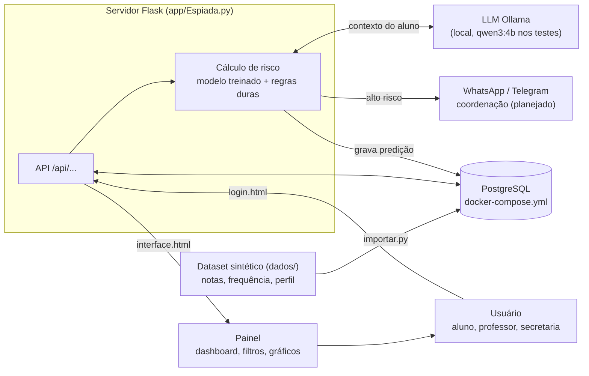
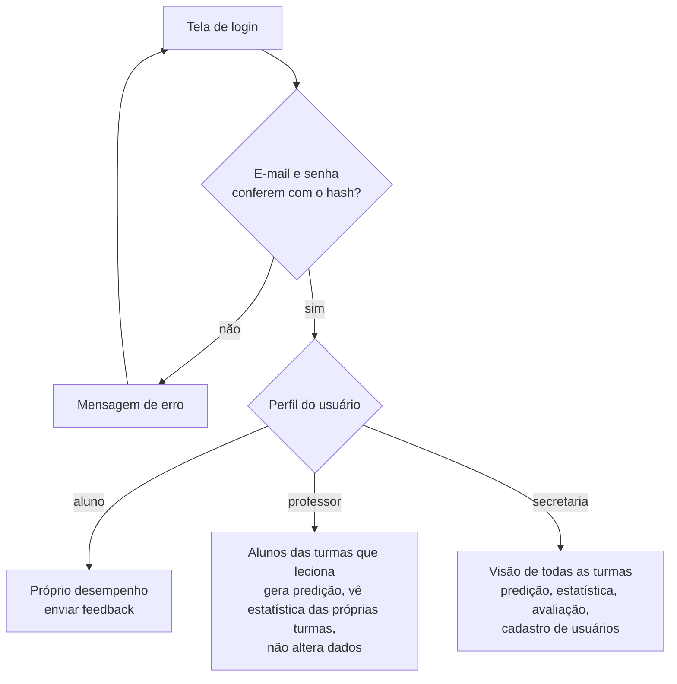
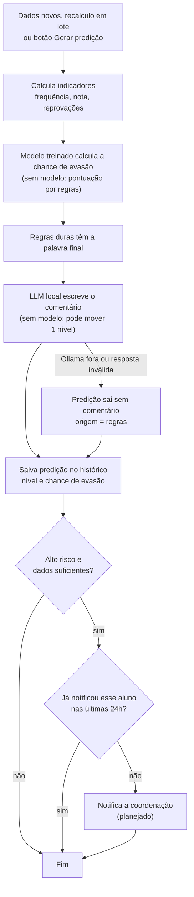
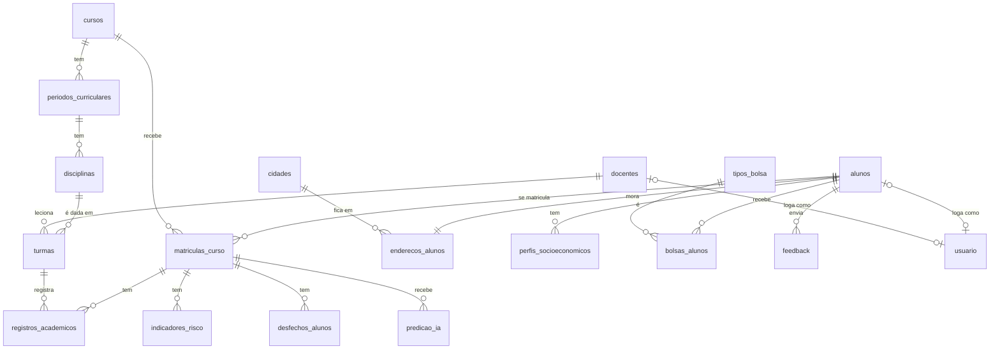

# Espiada: Sistema de Monitoramento e Predição de Risco de Evasão Acadêmica (SIMPA)

Projeto do curso de Inteligência Artificial da Universidade Evangélica de Goiás (UniEVANGÉLICA), Anápolis, Goiás.

O Espiada é um sistema web que acompanha o desempenho dos alunos e aponta quem corre risco de evadir. Ele reúne notas, frequência e perfil de cada aluno num único banco, calcula um nível de risco (baixo, médio ou alto) e mostra num painel os alunos que precisam de atenção, para que a coordenação e os professores possam agir antes da evasão acontecer. Cada perfil de acesso enxerga só os alunos que pode ver.

## Autores

- Diego Garcez: full stack e documentação
- André Ribeiro: banco de dados e integração de llm

## O que o sistema faz

- **Importação dos dados acadêmicos:** notas, frequência, endereço e perfil socioeconômico entram no banco só pelo importador (`scripts/importar.py`), a partir de um dataset sintético com 5000 alunos e 450 docentes de Engenharia de Software (2023-1 a 2026-2). Os 120 alunos originais foram ampliados por `scripts/ampliar_dados.py`, na proporção de 18 docentes a cada 200 alunos. Nenhum registro é de uma pessoa real, e nenhuma tela permite editar nota ou frequência.
- **Painel geral:** cards com o total de alunos e quantos estão em risco alto, médio e baixo, a lista dos alunos em risco crítico e quatro tipos de gráfico: barras (% de alto risco por período), barras empilhadas (alto, médio e baixo por período), rosca (distribuição geral) e radar (alunos com risco por período). Também mostra média, mediana, desvio padrão e quartis de nota e frequência. O filtro por período vale para o painel inteiro. Os gráficos são desenhados à mão em CSS e SVG, sem biblioteca.
- **Monitoramento:** tabela com todos os alunos visíveis, com período, frequência, nota, reprovações e risco. Tem busca por nome e filtros por período e por nível de risco. Clicar no aluno abre a ficha dele.
- **Ficha do aluno:** notas e frequência de cada disciplina, separadas por semestre, a evolução com a tendência e o histórico de predições de risco.
- **Predição de risco:** o professor ou a secretaria escolhe um aluno e gera a classificação. O modelo treinado calcula a chance de evasão, que aparece junto do nível (por exemplo, "Risco alto — 62%"), as regras duras têm a palavra final e uma LLM local escreve o comentário. A tela também mostra os fatores e os ajustes das regras duras. O aluno vê o próprio nível, mas não a porcentagem. A seção [Como o risco é calculado](#como-o-risco-é-calculado) explica cada passo.
- **Recálculo em lote:** a secretaria pode recalcular a predição de todos os alunos de uma vez, em segundo plano, pelo botão Recalcular da aba Config., que mostra o andamento. Quem não mudou desde a última análise é pulado.
- **Histórico que não se perde:** cada predição vira uma linha nova no banco. Nada é sobrescrito, então dá para ver como o risco de um aluno mudou ao longo do tempo.
- **Perfis de acesso:** o aluno vê só o próprio desempenho; o professor vê só os alunos que passaram pelas turmas dele; a secretaria vê todos e cadastra usuários. Qualquer tentativa fora disso é negada e registrada no log.
- **Feedback do aluno:** na tela Meu desempenho, o aluno avalia o curso ou a instituição (nota de 1 a 5 e comentário opcional) e vê a lista dos feedbacks que já enviou. O professor e a secretaria veem os feedbacks na ficha do aluno. Avaliação 1 ou 2 conta como reclamação no cálculo de risco.
- **Avaliação do modelo:** a secretaria vê quanto o risco previsto acerta, comparado com quem de fato evadiu: matriz de confusão, precisão, revocação, F1, curva ROC, intervalos de confiança de 95%, o acerto por período e por turma e a comparação pareada entre regras e LLM. A seção [Avaliação do modelo de risco](#avaliação-do-modelo-de-risco) explica as regras.
- **Estatística:** medidas descritivas, histogramas, boxplots, aprovação e reprovação, evolução por semestre e exportação em CSV, com filtros por período, semestre, disciplina e turma. O professor vê só as próprias turmas. A secretaria também vê os fatores ligados à evasão e a comparação entre grupos. A seção [Estatística](#estatística) explica cada cálculo.
- **Turmas:** a aba Turmas lista as turmas com disciplina, docente, semestre, turno, modalidade e vagas, com busca e filtro por semestre.
- **Cadastro de usuários:** a secretaria cadastra aluno, professor ou secretaria pela aba Config.

## Como o risco é calculado

**Com modelo treinado** (o caso normal), o nível vem da chance de evasão calculada por ele: abaixo de 15% é baixo, de 15% a 30% é médio e a partir de 30% é alto. As regras duras têm a palavra final e a LLM só escreve o comentário. A seção [Treinamento do modelo de risco](#treinamento-do-modelo-de-risco) explica como ele aprende.

**Sem modelo treinado**, o cálculo tem três camadas: uma pontuação por regras, uma opinião da LLM e as regras duras. A pontuação e os fatores mostram **por que** o sistema apontou risco; a LLM é uma análise complementar.

**Pontuação por regras.** Cada sinal de alerta soma pontos: frequência média abaixo de 75% (+2), nota média abaixo de 60 (+2), reprovação no histórico (+1), reclamação no feedback, ou seja, avaliação 1 ou 2 (+1), e morar a mais de 30 km do campus (+1). Com 4 pontos ou mais o risco é alto, com 2 ou 3 é médio, e abaixo disso é baixo. Um indicador sem dado, como o de um aluno ainda sem notas, não soma ponto. Os pesos estão na lista `REGRAS` de `app/models/predicao.py`.

**Opinião da LLM.** A LLM recebe os indicadores do aluno, o resumo de cada semestre (nota média, frequência média e reprovações), os três últimos comentários dele e a pré-análise das regras. Com isso ela enxerga o que as médias escondem: a tendência entre os semestres e o tom dos comentários. Ela devolve um nível e um comentário curto, num JSON com formato obrigatório. Não é um chat: o prompt é fixo e ninguém digita nada para ela. O comentário do aluno entra como dado, e o prompt manda ignorar qualquer ordem escrita nele.

**Limite da LLM.** Sem modelo treinado, a LLM pode mudar o nível das regras em no máximo um degrau (`LLM_PASSO_MAXIMO`). Se as regras dizem "baixo", ela pode chegar no máximo a "médio".

**Regras duras.** Valem por cima do modelo, da pontuação e da LLM. Por isso, um aluno pode aparecer como "Risco alto — 22%": a porcentagem continua sendo a estimativa do modelo, e o nível subiu por causa da regra:

- frequência abaixo de 75% deixa o risco em **alto**;
- menos de 8 registros acadêmicos (`HISTORICO_MINIMO`) limitam o risco a **médio**, porque ainda não há dados suficientes para cravar "alto";
- quando as duas valem ao mesmo tempo, o histórico curto vence e o risco fica **médio**.

**Sem a LLM.** Se o Ollama estiver fora do ar ou a resposta vier fora do formato, a predição sai sem comentário, usando o modelo treinado (ou só as regras, se não houver modelo), fica marcada com `origem = regras` e a tela mostra o aviso com o motivo. O sistema nunca deixa de funcionar por causa da LLM.

### A LLM

**Nos nossos testes locais usamos o `qwen3:4b`** (4 bilhões de parâmetros), rodando na própria máquina pelo [Ollama](https://ollama.com). Nenhum dado vai para a nuvem.

A escolha do modelo muda pouco a predição, desde que ele tenha **pelo menos 2 bilhões de parâmetros**. O motivo está no próprio desenho: a LLM só pode mover o nível das regras em um degrau, e as regras duras valem por cima dela. Para usar outro modelo, basta definir a variável de ambiente `OLLAMA_MODEL` antes de subir o servidor (por exemplo, no PowerShell, `$env:OLLAMA_MODEL = "qwen3:4b"`).

O `qwen3:4b` foi usado **só em testes locais**. Os dados enviados a ele **não passaram por tratamento de acordo com a LGPD**: o sistema não manda nome, matrícula nem endereço, mas isso não foi avaliado como anonimização nos termos da lei.

A temperatura é 0 e a semente é fixa, então a mesma entrada dá a mesma resposta. O modelo fica carregado na memória por 30 minutos depois de cada uso; a primeira chamada é a mais lenta, porque carrega o modelo. As outras variáveis opcionais são `OLLAMA_URL` (padrão `http://localhost:11434`) e `OLLAMA_TIMEOUT` (padrão 120 segundos).

**Recálculo em lote.** Pelo terminal, `flask --app app/Espiada.py recalcular-predicoes` analisa todos os alunos (`--forcar` reanalisa também quem não mudou). Pela API, a secretaria usa `POST /api/predicoes/recalcular` e acompanha o andamento em `GET /api/predicoes/recalculo`. Para saber quem mudou, o sistema guarda a cada análise um resumo (hash) do que a LLM recebeu, junto com o modelo e a versão do prompt; se o resumo for igual ao da última análise, o aluno é pulado. Antes de começar, o sistema confere se o Ollama responde, e se a LLM falhar três vezes seguidas, o lote para.

## Avaliação do modelo de risco

A aba **Avaliação** (só a secretaria; rota `GET /api/avaliacao`) compara o risco previsto com o que de fato aconteceu. A tabela `desfechos_alunos` é o gabarito: diz quem evadiu na janela de 12 meses (640 dos 5000 alunos, 12,8%). O código fica em `app/models/avaliacao.py`, e o gabarito só é lido ali, para medir o acerto e servir de resposta no treinamento; ele nunca é variável de entrada do cálculo do risco.

**As regras da avaliação**

1. **O que conta como acerto.** Evasão é o caso "positivo". Para virar uma previsão de sim ou não, o nível de risco passa por um **corte**, escolhido na tela: **médio ou alto** (padrão: médio e alto contam como "previu evasão") ou **só alto** (mais exigente).
2. **Matriz de confusão.** Cada aluno cai numa de quatro caixas: **verdadeiro positivo** (previu e evadiu), **falso positivo** (previu e o aluno ficou: alarme falso), **falso negativo** (não previu e o aluno evadiu: escapou) e **verdadeiro negativo** (não previu e o aluno ficou).
3. **Métricas**, todas tiradas da matriz (VP, FP, FN e VN são as quatro caixas):

   | Métrica | Conta | O que responde |
   |---|---|---|
   | Acurácia | (VP + VN) / total | Quantos alunos o modelo classificou certo |
   | Precisão | VP / (VP + FP) | De quem o modelo apontou, quantos evadiram de fato |
   | Revocação (sensibilidade) | VP / (VP + FN) | De quem evadiu, quantos o modelo apontou antes |
   | Especificidade | VN / (VN + FP) | De quem ficou, quantos o modelo não apontou |
   | F1 | 2 × precisão × revocação / (precisão + revocação) | Equilíbrio entre precisão e revocação |

   Quando a conta divide por zero (por exemplo, precisão com ninguém apontado), o resultado aparece como "—".
4. **A acurácia engana aqui.** Como só 12,8% evadem, quem "chuta" que ninguém evade já acerta 87,2% sem prever nada. Por isso as medidas que importam são revocação, precisão, F1 e AUC.
5. **AUC e curva ROC.** A AUC é a chance de um aluno que evadiu, sorteado, ter pontuação de risco maior que um aluno que ficou (empate conta meio). 0,5 é o mesmo que sortear; 1 separa todo mundo. O cartão da tela mostra a AUC do **nível final** (baixo, médio, alto), que é o que o sistema entrega. A AUC da pontuação (0 a 7, antes das regras duras) acompanha a curva ROC, em que cada ponto é um corte da pontuação: quanto mais a curva sobe à esquerda da diagonal, melhor.
6. **Evasão real por nível.** Mostra a taxa de evasão dos alunos de cada nível. Se o modelo ordena bem, ela sobe de baixo para alto.
7. **LLM x regras.** Entram só os alunos cuja última predição guardada veio da LLM, e as regras são medidas **nesses mesmos alunos**, para a comparação ser justa. Predições feitas com o modelo treinado não entram, porque nelas a LLM só comenta. Com menos de 10 alunos que evadiram ou 10 que ficaram (`EVENTOS_MINIMOS`), a tela avisa que não dá para concluir nada. Se só parte dos alunos tiver predição da LLM, a tela avisa que o resultado vale apenas para esse grupo, porque ele pode não ser uma amostra aleatória.
8. **Intervalo de confiança de 95% (IC 95%).** Mostra a faixa de valores plausíveis para cada medida, dada a quantidade de alunos. As proporções usam o método de **Wilson** e a AUC usa o de **DeLong**, que trata empates. O F1 fica sem intervalo. O IC cobre só a incerteza da amostra: como os dados são sintéticos e o desfecho foi gerado a partir de indicadores parecidos com os das regras, ele não mostra se o modelo funcionaria com alunos reais.

**Resultado atual das regras (5000 alunos)**

| Nível | Alunos | Evadiram | Taxa de evasão |
|---|---|---|---|
| Alto | 488 | 195 | 40,0% |
| Médio | 1200 | 227 | 18,9% |
| Baixo | 3312 | 218 | 6,6% |

| Corte | Precisão | Revocação | F1 |
|---|---|---|---|
| Médio ou alto | 25,0% | 65,9% | 0,362 |
| Só alto | 40,0% | 30,5% | 0,346 |

A AUC do nível final é 0,707 (IC 95%: 0,686 a 0,728) e a da pontuação é 0,745 (IC 95%: 0,724 a 0,765). As regras ordenam bem (no nível alto a evasão é 6 vezes a do baixo), mas deixam escapar 218 evasões classificadas como baixo risco (34% delas).

## Treinamento do modelo de risco

Treinar é fazer o computador descobrir os pesos do cálculo olhando alunos cujo resultado já é conhecido. O modelo é uma **regressão logística**, escrita sem biblioteca nova em `app/models/treino.py`. Para treinar, com o banco no ar:

```
flask --app app/Espiada.py treinar-modelo
```

1. **Variáveis.** Nota e frequência médias, nota do semestre atual, taxa e quantidade de reprovações, período e tendência (inclinação de nota e frequência por semestre, queda de nota e mudança no último semestre). Não entram nome, matrícula, gênero, renda, endereço, `indicadores_risco` nem o próprio gabarito.
2. **Divisão.** 80% dos alunos treinam e 20% ficam guardados para o teste, com a mesma proporção de evasão nos dois grupos.
3. **Ajuste.** O modelo aprende os pesos nos 4000 alunos de treino. A validação cruzada de 5 dobras confere se o resultado é estável.
4. **Teste.** O modelo prevê os 1000 alunos que nunca viu, e a previsão é comparada com o que aconteceu.
5. **Aprovação.** A nova versão só entra em uso se o ganho de AUC sobre a referência (as regras ou o modelo atual) for positivo em todo o intervalo de confiança de 95%. Toda tentativa fica guardada na tabela `modelo_risco`.

**Resultado da versão 1 (1000 alunos de teste, 128 evasões)**

| Medida | Regras | Modelo |
|---|---|---|
| AUC da ordenação | 0,747 | 0,789 (IC 95%: 0,745 a 0,834) |
| AUC do nível final | 0,709 | 0,754 |
| Precisão (médio ou alto) | 24,5% | 33,0% |
| Revocação (médio ou alto) | 65,6% | 68,0% |
| Revocação (só alto) | 34,4% | 49,2% |

O ganho de AUC sobre as regras é de 0,042 (IC 95%: 0,007 a 0,079). A porcentagem é calibrada: no grupo de maior risco do teste, o modelo previu 38,0% de evasão e 37,0% evadiram. Nos 5000 alunos, a maior chance estimada é 74%, e a média é de 42% no nível alto, 21% no médio e 6% no baixo.

## Estatística

A aba **Estatística** usa `app/models/estatistica.py` (consultas e organização) e `app/models/inferencia.py` (testes estatísticos feitos à mão, sem biblioteca nova). O professor vê só os registros das próprias turmas. A secretaria vê todos e é a única que acessa fatores de evasão e comparação entre grupos, porque eles usam o desfecho e o perfil socioeconômico. O desfecho é lido só por `avaliacao.gabarito()` e nunca volta para a predição.

**Como cada resultado é calculado**

- **Unidade de análise.** Medidas, distribuições e aprovação contam registros (uma matrícula em uma disciplina). Fatores e comparações contam alunos, um por pessoa, para que quem cursou mais disciplinas não pese mais.
- **Medidas descritivas.** Quartis por interpolação linear (`percentile_cont`), desvio padrão amostral e moda só quando algum valor se repete. Na disciplina em curso vale a nota parcial. Valor atípico é o que fica a mais de 1,5 intervalo interquartil dos quartis.
- **Aprovação.** As taxas usam só matrículas concluídas, com intervalo de Wilson. O ranking de turmas exige pelo menos 20 matrículas concluídas.
- **Evolução.** A tendência é a inclinação da regressão linear das médias por semestre. O semestre em curso aparece no gráfico, mas fica fora da conta, porque nota parcial não se compara com nota final. Sem filtro, cada semestre mistura grupos de ingresso; o filtro por período acompanha um mesmo grupo.
- **Fatores.** Taxa de evasão por grupo com IC 95%, razão de chances (Woolf), qui-quadrado e V de Cramér, que mede o tamanho da associação. Correlações de Pearson e Spearman com a evasão.
- **Comparação entre grupos.** Diferença de médias com IC 95%, teste t de Welch, Mann-Whitney e d de Cohen. A tela só marca diferença quando os dois testes concordam.
- **Vários testes de uma vez.** Os valores-p usam a correção de Holm dentro de cada tabela, para reduzir falsos achados.
- **Avaliação por período e turma.** Usa só os alunos que o modelo não viu no treino. Se os dados mudaram e a divisão não reproduz a AUC guardada, a tela pede um novo treino. Grupo com menos de 10 evasões ou permanências não recebe AUC; hoje isso vale para o 1º período e para todas as turmas.
- **LLM x regras.** O teste de McNemar compara os dois nos mesmos alunos: binomial exato até 25 discordâncias e qui-quadrado acima disso.
- **CSV.** Cada tabela sai com ponto e vírgula e vírgula decimal, para abrir direto no Excel em português, e respeita os filtros e o perfil.

**Como ler os resultados.** Associação não prova causa, e os dados são sintéticos. Com 5000 alunos, até um efeito muito pequeno fica estatisticamente significativo, então o tamanho do efeito importa tanto quanto o valor-p. A razão de chances da tabela não é ajustada: morar a mais de 30 km aparece com 1,22 sozinho, mas cai para 1,08 ao considerar nota, frequência e reprovações, porque quem mora longe tende a ter frequência menor.

## Tecnologias

Docker e Docker Compose para rodar o sistema inteiro, Python 3.14 na imagem (3.10+ fora dela), Flask, Waitress (servidor da aplicação no Docker), Werkzeug (hash de senha e erros HTTP), Click (comandos de terminal), PostgreSQL 17 (com o driver `psycopg`), Ollama com o cliente `ollama` para Python e HTML, CSS e JavaScript puro nas telas. A fonte Inter é servida pelo próprio sistema. A arquitetura é MVC: os models guardam os dados e as regras, as views são as telas e os controllers recebem os pedidos, conferem login e perfil e devolvem JSON.

## Como executar

O sistema inteiro roda no Docker: a aplicação (`web-espiada`) e o PostgreSQL (`banco-espiada`). Não é preciso instalar Python nem PostgreSQL.

1. Instale e abra o [Docker Desktop](https://www.docker.com/products/docker-desktop/).
2. Baixe o código (botão **Code** e depois **Download ZIP**) e extraia em uma pasta. Se preferir, clone o repositório com o git:

   ```
   git clone https://github.com/DiegoGDutra/Projeto-Espiada
   ```

3. (Recomendado) Copie `.env.example` para `.env` e preencha `SECRET_KEY`. Sem ela, reiniciar o container desloga todo mundo.
4. Abra o terminal na pasta do projeto, a que contém o `docker-compose.yml`, e suba tudo:

   ```
   docker compose up -d --build
   ```

   Na primeira vez, o sistema cria as tabelas, importa o dataset, cria os logins e treina o modelo de risco, sozinho e em poucos segundos depois de baixar as imagens. Nas próximas, ele não mexe nos dados que já existem.

5. Abra no navegador:

   ```
   http://127.0.0.1:5000
   ```

Os containers voltam sozinhos sempre que o Docker inicia. Ative no Docker Desktop a opção de iniciar com o Windows para o sistema subir junto com o computador.

**Comandos do dia a dia**

| Para | Comando |
|---|---|
| Aplicar uma mudança no código | `docker compose up -d --build` |
| Ver o log da aplicação | `docker compose logs -f web` |
| Parar sem apagar nada | `docker compose stop` |
| Treinar o modelo de novo | `docker compose exec web flask --app app/Espiada.py treinar-modelo` |
| Recalcular as predições | `docker compose exec web flask --app app/Espiada.py recalcular-predicoes` |
| Rodar um teste | `docker compose exec web python testes/teste_api.py` |
| Zerar o banco (**apaga os dados**) | `docker compose down -v` e depois `docker compose up -d --build` |

Os testes são `teste_banco.py`, `teste_api.py`, `teste_llm.py`, `teste_modelo.py` e `teste_estatistica.py`. Eles não precisam do Ollama e usam esquemas próprios do banco (`teste_banco`, `teste_api`, `teste_llm`, `teste_modelo`, `teste_estatistica`), recriados a cada execução, sem mexer nos dados de verdade.

**A LLM (opcional).** Sem ela, a predição sai normalmente, só que sem o comentário. Por padrão, o container usa o [Ollama](https://ollama.com/download) instalado no computador, que precisa estar aberto e com o modelo baixado:

```
ollama pull qwen3:4b
```

No Linux, o Ollama do computador precisa aceitar conexões do Docker (`OLLAMA_HOST=0.0.0.0`). Quem preferir o Ollama também em container coloca `OLLAMA_URL=http://ollama:11434` no `.env` e roda os comandos abaixo. A imagem tem cerca de 3,4 GB comprimidos, além do modelo, e no Docker do Windows uma placa AMD não é aproveitada, então a LLM roda no processador.

```
docker compose --profile ollama up -d --build
```

```
docker compose exec ollama ollama pull qwen3:4b
```

**Rodar fora do Docker (para desenvolver).** Com Python 3.10+, deixe só o banco no Docker e libere a porta 5000:

```
docker compose stop web
```

```
pip install -r requirements.txt
```

```
python app/Espiada.py
```

Nesse modo, o sistema usa o banco em `127.0.0.1:5432` (ou o endereço da variável `DATABASE_URL`) e o servidor de desenvolvimento do Flask, que recarrega ao salvar o código. Se o banco estiver vazio, rode antes `python scripts/importar.py` e `flask --app app/Espiada.py treinar-modelo`.

## Acesso ao sistema

O importador cria um login padrão de cada perfil:

- Secretaria: `secretaria@simpa.test`, senha `Secretaria#2026` (vê os 5000 alunos)
- Professor: `professor@simpa.test`, senha `Professor#2026` (vê os 483 alunos que passaram pelas turmas dele)
- Aluno: `aluno@simpa.test`, senha `Aluno#2026` (Estudante Sintético 001, matrícula `AES0001`)

Os demais alunos e docentes também ganham login, com a senha padrão do perfil: `aes0002@simpa.test` a `aes5000@simpa.test` (senha `Aluno#2026`) e `docente2@simpa.test` a `docente450@simpa.test` (senha `Professor#2026`).

Essas senhas existem apenas para facilitar os testes e devem ser trocadas em qualquer uso real. Outros usuários são cadastrados pelo terminal, com `docker compose exec web flask --app app/Espiada.py criar-usuario fulano@exemplo.com professor "Fulano" --vinculo 2`, pela rota `POST /api/usuarios` ou pela aba Config. (só secretaria).

A senha precisa ter 8 ou mais caracteres, com maiúscula, minúscula, número e caractere especial, e fica guardada no banco apenas como hash. Depois de 5 senhas erradas seguidas, o login fica bloqueado por 15 minutos. A sessão fica num cookie assinado e protegido (`HttpOnly`, `SameSite=Strict`). Em uso real, defina a variável de ambiente `SECRET_KEY`; sem ela, o servidor gera uma chave nova a cada vez que sobe e todo mundo precisa entrar de novo.

## Privacidade e LGPD

O Espiada trata dados acadêmicos e socioeconômicos de alunos, protegidos pela Lei nº 13.709/2018 (LGPD). Por isso o sistema tem a página `/sobre.html`, acessível sem login pelo rodapé de qualquer tela, com as abas Termos de Uso, Privacidade (LGPD), Cookies e Contato.

A política de privacidade descreve os dados coletados, a finalidade, a base legal, as decisões automatizadas (o aluno pode pedir revisão da classificação de risco e saber quais critérios foram usados), o armazenamento e os direitos do titular (artigo 18 da LGPD). Cada perfil recebe só os dados dos alunos que pode ver, e a LLM roda local, sem mandar nada para a nuvem. As estatísticas e os CSV trazem só resultados agregados, sem nome nem matrícula; a análise que usa o perfil socioeconômico é só da secretaria. Em grupos pequenos, um agregado ainda pode permitir identificar alguém, e o sistema ainda não define um tamanho mínimo de grupo. Os dados enviados à LLM ainda **não passaram por tratamento de acordo com a LGPD** (veja [A LLM](#a-llm)).

## Termos de uso e créditos

A mesma página `/sobre.html` tem as abas Sobre e Equipe, com a ficha técnica do projeto e os autores. Os Termos de Uso deixam claro que o nível de risco é um **apoio à decisão**, não uma conclusão sobre o aluno, e que qualquer ação deve ser avaliada por uma pessoa.

O código e o conteúdo do Espiada pertencem aos autores. Os componentes de terceiros seguem as próprias licenças: a fonte Inter, sob a SIL Open Font License 1.1 (`app/static/fontes/OFL.txt`), e o Flask, sob a licença BSD-3-Clause.

## Estrutura do projeto

```
Projeto-Espiada/
├── requirements.txt                 # dependências
├── docker-compose.yml               # sistema inteiro: aplicação, PostgreSQL e Ollama opcional
├── Dockerfile                       # imagem da aplicação
├── .dockerignore                    # lista do que pode entrar na imagem
├── .env.example                     # modelo do .env (SECRET_KEY e LLM)
├── roadmap.md                       # andamento de cada funcionalidade
├── dados/                           # dataset sintético em CSV e o dicionário das colunas
├── scripts/                         # ferramentas que rodam à parte do sistema
│   ├── iniciar.py                   # entrada do container: prepara o banco e sobe o servidor
│   ├── importar.py                  # carrega o dataset no banco e cria os logins
│   └── ampliar_dados.py             # amplia o dataset de dados/ para 5000 alunos
├── testes/
│   ├── teste_banco.py               # testes das regras do banco
│   ├── teste_api.py                 # testes das rotas e permissões
│   ├── teste_llm.py                 # testes da LLM com um Ollama simulado
│   ├── teste_modelo.py              # testes do treinamento e da porcentagem de risco
│   └── teste_estatistica.py         # testes das contas, dos totais, das permissões e do CSV
└── app/                             # o sistema, em MVC
    ├── Espiada.py                   # ponto de entrada: cria o app, registra os controllers, trata erros
    ├── schema.sql                   # tabelas e regras do banco
    ├── models/                      # M: dados e regras de negócio
    │   ├── banco.py                 # conexão PostgreSQL, transações e erros
    │   ├── usuario.py               # cadastro e autenticação
    │   ├── academico.py             # cursos, disciplinas, docentes e turmas
    │   ├── alunos.py                # resumo com indicadores, ficha e quem pode ver quem
    │   ├── predicao.py              # regras, regras duras, decisão final, recálculo e histórico
    │   ├── modelo_risco.py          # variáveis do aluno e chance de evasão pelo modelo treinado
    │   ├── treino.py                # treina, testa e aprova o modelo de risco
    │   ├── llm.py                   # cliente do Ollama: prompt fixo e resposta validada
    │   ├── avaliacao.py             # compara o risco previsto com o gabarito (matriz de confusão, F1, AUC, IC 95%)
    │   ├── estatistica.py           # medidas, distribuições, aprovação, evolução, fatores e CSV
    │   ├── inferencia.py            # testes estatísticos (qui-quadrado, Welch, Mann-Whitney, Holm, McNemar)
    │   └── feedback.py              # comentários do aluno
    ├── controllers/                 # C: rotas HTTP
    │   ├── comum.py                 # leitura de JSON e checagem de perfil
    │   ├── auth.py                  # login, logout, sessão, cadastro e comando criar-usuario
    │   ├── paginas.py               # entrega as telas
    │   ├── academico.py             # cursos, disciplinas, docentes e turmas
    │   ├── alunos.py                # lista, ficha, feedback e predição
    │   ├── predicoes.py             # recálculo em lote e comandos recalcular-predicoes e treinar-modelo
    │   └── estatisticas.py          # rotas de estatística e exportação em CSV
    ├── views/                       # V: telas
    │   ├── login.html               # login
    │   ├── interface.html           # painel, monitoramento, predições, estatística, avaliação e meu desempenho
    │   └── sobre.html               # sobre, equipe, termos, privacidade, cookies e contato
    └── static/fontes/               # fonte Inter e licença
```

Uma requisição sempre faz o mesmo caminho: a tela chama a API, o controller confere login e perfil, o model consulta ou grava no banco e aplica a regra, o controller devolve JSON e a tela desenha o resultado.

## Fluxo do sistema

### Visão geral

Os dados acadêmicos vêm do dataset sintético, importado por `scripts/importar.py` (ninguém edita nota ou frequência à mão). O servidor guarda tudo no PostgreSQL, calcula a chance de evasão e o nível de risco de cada aluno, pede para a LLM local explicar o resultado e mostra o resultado no painel conforme o perfil de quem entrou. O aviso à coordenação por WhatsApp ou Telegram ainda é planejado.



### Login e perfis

Cada perfil vê só o que pode.



### Predição de risco

Roda quando alguém clica em **Gerar predição** (um aluno) e no **recálculo em lote**, que pula quem não mudou desde a última análise da LLM. Cada predição vira uma linha nova em `predicao_ia`, então o histórico do aluno nunca se perde. Os detalhes de cada passo estão em [Como o risco é calculado](#como-o-risco-é-calculado).



## Banco de dados e API

O banco tem 18 tabelas, criadas a partir de `app/schema.sql`. As regras de validação ficam no próprio banco: nota e frequência, por exemplo, só aceitam valores de 0 a 100. As tabelas formam quatro grupos:

- **Estrutura acadêmica:** `cursos`, `periodos_curriculares`, `disciplinas`, `turmas` e `docentes`. A turma liga uma disciplina e um docente num semestre.
- **O aluno:** `alunos` (o `codigo_academico`, como `AES0001`, é a matrícula), `matriculas_curso`, `registros_academicos` (notas e frequência por turma e tentativa), `enderecos_alunos`, `cidades`, `perfis_socioeconomicos`, `tipos_bolsa` e `bolsas_alunos`.
- **Avaliação:** `indicadores_risco` traz um risco já calculado pelo dataset e **não** entra na predição, porque seria copiar a resposta; `desfechos_alunos` diz quem de fato evadiu em 12 meses e serve só para medir se a predição acerta.
- **Do sistema:** `usuario`, `feedback` e `predicao_ia`, o histórico de predições com o nível, a origem (`llm` ou `regras`), o modelo e os detalhes do cálculo.



Na ponta de cada ligação, `||` quer dizer exatamente um, `o|` zero ou um e `o{` zero ou muitos. Por exemplo, `cursos ||--o{ periodos_curriculares` diz que um curso tem zero ou muitos períodos e cada período pertence a exatamente um curso. As relações de muitos para muitos passam por uma tabela intermediária: alunos e cursos por `matriculas_curso`, alunos e bolsas por `bolsas_alunos`, matrículas e turmas por `registros_academicos`.

A API fica toda em `/api/...`, usa JSON na entrada e na saída e exige login em todas as rotas, menos `POST /api/login`. Os erros vêm sempre como `{"erro": "..."}`, com o status HTTP correspondente (400 dado inválido, 401 sem login, 403 sem permissão, 404 não encontrado, 409 já existe, 429 login bloqueado, 503 Ollama fora no recálculo). As rotas são:

- **Sessão e usuários:** `POST /api/login`, `POST /api/logout`, `GET /api/sessao` e `POST /api/usuarios` (só secretaria).
- **Estrutura acadêmica:** `GET /api/cursos`, `/api/disciplinas`, `/api/docentes` e `/api/turmas`.
- **Alunos:** `GET /api/alunos` (lista com indicadores e risco atual), `GET /api/alunos/{matricula}` (ficha com as disciplinas) `POST /api/alunos/{matricula}/feedback` (só o próprio aluno) e `GET` na mesma rota (feedbacks do aluno, para quem pode vê-lo).
- **Predições:** `POST /api/alunos/{matricula}/predicao` gera e grava uma predição, e `GET` na mesma rota devolve o histórico; `POST /api/predicoes/recalcular` e `GET /api/predicoes/recalculo` cuidam do recálculo em lote, e `GET /api/avaliacao` mede o acerto das predições (só secretaria).
- **Estatística:** `GET /api/estatisticas` (tudo da aba, com filtros `periodo`, `semestre`, `disciplina` e `turma`), `/api/estatisticas/opcoes`, `/api/estatisticas/descritiva` e `/api/estatisticas/exportar/{tabela}` para professor e secretaria; `/api/estatisticas/evasao` e `/api/estatisticas/avaliacao` só para a secretaria.

## Limitações conhecidas

**A avaliação não prova acerto com alunos reais.** O desfecho do dataset foi sorteado a partir de uma fórmula que usa nota, frequência, reprovações e distância, quase as mesmas variáveis das regras. A AUC mede, portanto, o quanto as regras se aproximam do gerador dos dados (o score do próprio gerador chega a 0,796). Validar o modelo de verdade exige dados reais.

**A tendência ainda não mostrou ganho.** O modelo calcula a tendência de notas e frequência, mas, em validação cruzada, ela não mudou a AUC (diferença de 0,000; IC 95%: -0,003 a 0,003). O dataset tem um único desfecho por aluno, e todas as evasões são de 2027. Medir a tendência de verdade exige saber quem evadiu em cada semestre, com dados reais.

**Regras e cortes.** As regras seguem como reserva e explicação dos fatores, com pesos definidos à mão. Nelas, morar a mais de 30 km não tem efeito significativo depois de considerar nota, frequência e reprovações (razão de chances de 1,08; IC 95%: 0,90 a 1,30). Os cortes do modelo (15% e 30%) foram fixados antes do teste e devem ser confirmados com a coordenação, conforme a quantidade de alunos que ela consegue atender.

**A LLM ainda não foi comparada em escala.** Com o modelo treinado em uso, a LLM só escreve o comentário. A comparação da aba Avaliação considera apenas predições feitas sem modelo, e hoje são poucas, então ainda não se sabe se a LLM melhoraria o acerto.

**Dados da LLM sem tratamento de LGPD.** A LLM foi usada só em testes locais com o `qwen3:4b`. O contexto enviado não leva nome, matrícula nem endereço, mas não passou por um tratamento de dados de acordo com a lei.

**Histórico mínimo provisório.** O corte de 8 registros para permitir risco alto é uma escolha provisória. No dataset, qualquer valor de 6 a 10 pega os mesmos 625 alunos do 1º período.

**Dados que o dataset não tem.** Entrega de atividades não existe no dataset, então não entra no cálculo. Cada período tem 625 alunos, divididos em seções de turma (A, B, C...) de 45 vagas, mas o painel agrupa por período; como todos do mesmo período entraram juntos, turma, período e ano de ingresso dão o mesmo agrupamento.

**Recálculo em memória.** O andamento do recálculo em lote e o bloqueio de login ficam na memória do servidor. Por isso o container roda um único processo com várias threads. Reiniciar o container zera esse estado, e fora do Docker o modo de desenvolvimento do Flask pode interromper o lote ao recarregar o código.

**Uso local.** No Docker, a aplicação roda no Waitress, sem modo debug, e as portas só aceitam conexões do próprio computador. Ainda não há HTTPS, e as senhas padrão e a do banco são de desenvolvimento, então o sistema não está pronto para produção. O Ollama em container foi configurado, mas não foi testado, porque a imagem é grande. O Ollama não tem autenticação: se `OLLAMA_URL` apontar para outra máquina, use só em rede confiável, porque os dados viajam sem criptografia.

## Próximos passos

- Validar o modelo treinado com dados reais e desfecho por semestre, para medir o efeito da tendência.
- Confirmar com a coordenação os cortes de 15% e 30% do nível de risco.
- Comparar com o Ollama nos 5000 alunos se a LLM melhora o acerto do modelo; ajustar o prompt com esse resultado.
- Tratar os dados enviados à LLM de acordo com a LGPD.
- Deixar os pesos das regras configuráveis, com rota e tela.
- Avisar a coordenação sobre alunos em alto risco por WhatsApp ou Telegram.
- Exportar relatórios em PDF e CSV, por aluno, turma e curso.
- Mostrar os alunos e o risco de cada turma na aba Turmas, com o professor vendo só as próprias turmas.
- Permitir a alteração manual de uma predição, sempre com justificativa.
- Recalcular automaticamente quando chegarem dados novos.
- Servir o sistema por HTTPS e testar com vários usuários ao mesmo tempo.

O andamento de cada funcionalidade está em [`roadmap.md`](roadmap.md).
