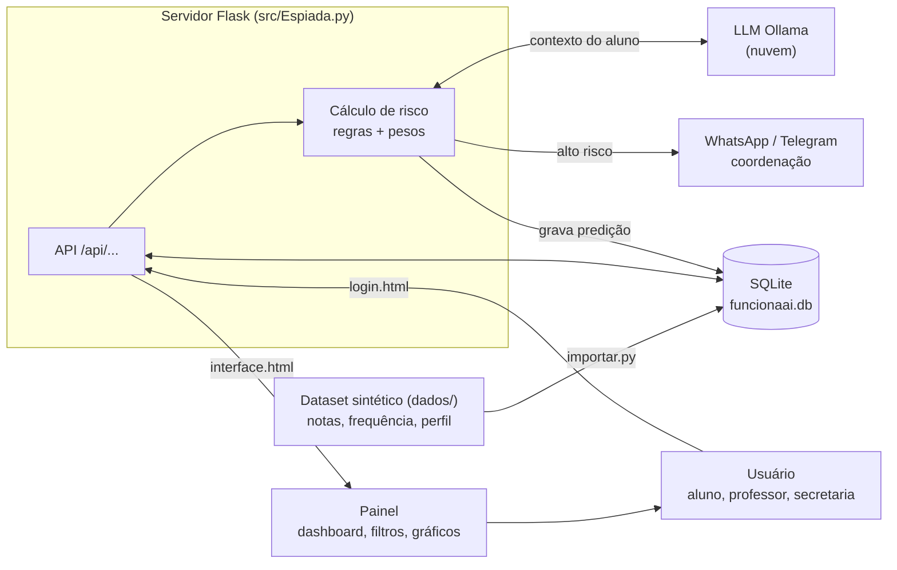
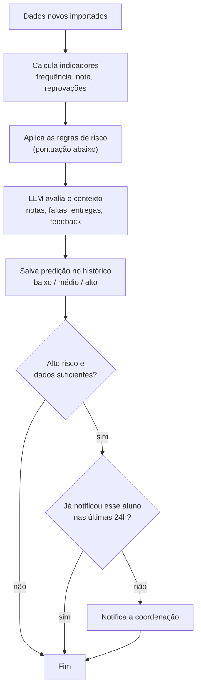
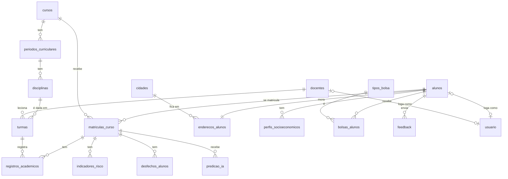

# Espiada — SIMPA

Sistema de monitoramento e predição de risco de evasão acadêmica. Flask + SQLite; servidor em `src/Espiada.py`.

## Tecnologias

| Parte | Tecnologia |
|---|---|
| Back-end | Python 3.10+ com Flask |
| Banco de dados | SQLite (`src/funcionaai.db`), tabelas em `src/schema.sql` |
| Dados | dataset sintético fornecido (`dados/`), importado por `src/importar.py` |
| Front-end | HTML + CSS + JavaScript puro (`login.html`, `interface.html`) |
| Predição (semana 06) | LLM em nuvem do Ollama (≥ 7B parâmetros) |

## Banco de dados

As tabelas estão em [`src/schema.sql`](src/schema.sql) e são criadas sozinhas quando o servidor sobe.

**Dados:** o projeto usa o **dataset sintético** fornecido à turma (pasta [`dados/`](dados/LEIA-ME.md): 120 alunos de Engenharia de Software, 2023-1 a 2026-2, nenhum registro real). O scraping do Lyceum foi descartado. A estrutura das tabelas acadêmicas é a do próprio dataset (significado de cada coluna em `dados/dicionario_dados.csv`). Os dados entram só por `python src/importar.py`, e nenhuma rota da API escreve nota ou frequência.
Para recriar o banco do zero: apague `src/funcionaai.db` e rode o importador de novo.

| Tabela | Guarda |
|---|---|
| `cursos`, `periodos_curriculares`, `disciplinas`, `turmas`, `docentes` | estrutura acadêmica; a turma liga disciplina + docente num semestre |
| `alunos` | aluno; `codigo_academico` (ex.: `AES0001`) é a matrícula |
| `matriculas_curso` | vínculo do aluno com o curso (período atual, turno, status) |
| `registros_academicos` | notas (0 a 100) e frequência de cada aluno em cada turma e tentativa |
| `enderecos_alunos`, `cidades` | onde o aluno mora e a distância até Anápolis |
| `perfis_socioeconomicos`, `tipos_bolsa`, `bolsas_alunos` | renda, trabalho, bolsas e financiamentos |
| `indicadores_risco` | risco já calculado pelo dataset (não usar como entrada da predição: vazamento) |
| `desfechos_alunos` | gabarito: evasão observada em 12 meses, para avaliar a predição |
| `usuario` | login de aluno, professor e secretaria (senha só em hash) — do sistema |
| `feedback` | comentários do aluno sobre o curso ou a instituição — do sistema |
| `predicao_ia` | histórico de predições do sistema (baixo/médio/alto); alteração manual exige justificativa — do sistema |

Para conferir as regras do banco: `python src/teste_banco.py`

## API

Tudo fica em `/api/...`, é organizado por recurso e usa JSON na entrada e na saída.
Para conferir as rotas: `python src/teste_api.py`

**Padrão das respostas**

| Status | Quando | Corpo |
|---|---|---|
| `200` | consulta ou atualização ok | o registro ou a lista |
| `201` | criou algo | o registro criado, com o id |
| `400` | JSON inválido, faltou campo ou violou uma regra do banco (ex.: nota 101) | `{"erro": "..."}` |
| `401` | não fez login (ou e-mail/senha errados) | `{"erro": "..."}` |
| `403` | o perfil não pode fazer isso (tentativa fica no log do servidor) | `{"erro": "sem permissão: ..."}` |
| `404` | aluno ou recurso não existe | `{"erro": "..."}` |
| `409` | já existe (ex.: matrícula repetida) | `{"erro": "..."}` |
| `429` | 5 senhas erradas seguidas no mesmo login: bloqueado por 15 min | `{"erro": "..."}` |

Um indicador sem dado ainda (ex.: aluno sem notas) vem como `null`.

### Login e perfis

O login é por e-mail e senha; a sessão fica num cookie assinado (`HttpOnly`, `SameSite=Strict`). Toda rota `/api/...` exige login, menos `POST /api/login`.
Senha: 8+ caracteres com maiúscula, minúscula, número e caractere especial, guardada só em hash.
Em produção defina a variável de ambiente `SECRET_KEY`; sem ela o servidor gera uma nova a cada vez que sobe (e todo mundo precisa logar de novo).

| Perfil | Vê | Pode |
|---|---|---|
| aluno | só o próprio resumo, disciplinas e histórico de predição | enviar feedback (só o próprio) |
| professor | só alunos que passaram por turmas dele; cursos, disciplinas, docentes, turmas | gerar predição desses alunos; não altera dado nenhum |
| secretaria | tudo | gerar predição de qualquer aluno, cadastrar usuários |

Qualquer pedido fora disso volta `403` e fica registrado no log do servidor (`acesso negado: ...`).

**Logins padrão:** o `src/importar.py` já cria um login de cada perfil (lista `LOGINS_PADRAO` no arquivo). Rodar o importador num banco que já tem dados só confere se esses logins existem e cria os que faltarem.

| Login | Senha | Perfil | Ligado a |
|---|---|---|---|
| `secretaria@simpa.test` | `Secretaria#2026` | secretaria | — (vê os 120 alunos) |
| `professor@simpa.test` | `Professor#2026` | professor | Docente Ada (`docente_id` 1, vê 78 alunos) |
| `aluno@simpa.test` | `Aluno#2026` | aluno | Estudante Sintético 001 (`AES0001`) |

São só para teste: fora do ambiente da turma, troque as senhas. Outros usuários são cadastrados pela secretaria na aba **Config.** do painel, ou pelo terminal (pede a senha duas vezes):

```bash
flask --app src/Espiada.py criar-usuario fulano@unievangelica.edu.br professor "Fulano" --vinculo 2
```

**Rotas** (campos obrigatórios em **negrito**)

| Método | Rota | Corpo (entrada) | Resposta |
|---|---|---|---|
| POST | `/api/login` | **login** (e-mail), **senha** | `{login, perfil, nome}` e abre a sessão |
| POST | `/api/logout` | — | `{ok: true}` |
| GET | `/api/sessao` | — | `{login, perfil, nome}` de quem está logado |
| POST | `/api/usuarios` | **login**, **perfil**, **nome**, **senha**, vinculo (matrícula do aluno ou `docente_id` do professor) | o usuário criado (só secretaria) |
| GET | `/api/cursos` | — | lista de cursos |
| GET | `/api/disciplinas` | — | lista de disciplinas |
| GET | `/api/docentes` | — | lista de docentes |
| GET | `/api/turmas` | — | lista de turmas |
| GET | `/api/alunos` | — | lista de resumos do aluno (abaixo) |
| GET | `/api/alunos/{matricula}` | — | resumo + `disciplinas` (notas e frequência por turma e tentativa) |
| POST | `/api/alunos/{matricula}/feedback` | **alvo** (`curso` ou `instituicao`), comentarios, avaliacao_curso (1–5) | o feedback registrado |
| POST | `/api/alunos/{matricula}/predicao` | — | `{matricula, risco, score, fatores}` e grava no histórico |
| GET | `/api/alunos/{matricula}/predicao` | — | histórico de predições, da mais nova para a mais antiga |

`{matricula}` é o `codigo_academico` do aluno (ex.: `AES0001`). Não existe rota para criar ou alterar nota e frequência: elas vêm só do importador.

**Resumo do aluno** (`GET /api/alunos`, o que o painel usa):

```json
{
  "matricula": "AES0001", "nome": "Estudante Sintético 001", "curso": "Engenharia de Software",
  "turma": "Lógica de Programação, Matemática Discreta, ...", "periodo": 1, "situacao": "ATIVO",
  "distancia": 55.0, "freq": 92.8, "nota": 88.9, "reprovacoes": 0, "reclamacoes": 0, "risco": "baixo"
}
```

**Predição** (`POST /api/alunos/{matricula}/predicao`):

```json
{
  "matricula": "AES0001", "risco": "alto", "score": 7,
  "fatores": [{"descricao": "Frequência abaixo de 75%", "negativo": true}]
}
```

**Erro:**

```json
{"erro": "campos obrigatórios: alvo"}
```

## Como executar

Precisa do **Python 3.10+** instalado.

1. Baixe o projeto e entre na pasta:
   ```bash
   git clone https://github.com/DiegoGDutra/Projeto-Espiada
   cd Projeto-Espiada
   ```
2. (Opcional) Crie e ative um ambiente virtual:
   ```bash
   python -m venv .venv
   .venv\Scripts\activate        # Windows
   source .venv/bin/activate     # Linux/Mac
   ```
3. Instale as dependências:
   ```bash
   pip install -r requirements.txt
   ```
   A única dependência externa é o **Flask**, que já instala junto Werkzeug, Jinja2, MarkupSafe, ItsDangerous, Click e Blinker. O `sqlite3` já vem com o Python.
4. Importe o dataset para o banco (só na primeira vez; já cria os logins padrão):
   ```bash
   python src/importar.py
   ```
5. Rode o servidor:
   ```bash
   python src/Espiada.py
   ```
6. Abra http://127.0.0.1:5000 — abre a tela de login (`login.html`); entre com um dos [logins padrão](#login-e-perfis) e vai para o painel (`interface.html`), que mostra só as abas do seu perfil.

Para parar o servidor: `Ctrl+C` no terminal.

## Fluxo do sistema

### Visão geral

Os dados acadêmicos vêm do dataset sintético fornecido, importado por `src/importar.py` (ninguém edita nota ou frequência à mão). O servidor guarda tudo no SQLite, calcula o risco de cada aluno, pede para a LLM avaliar o contexto e mostra o resultado no painel conforme o perfil de quem entrou.



### Login e perfis

Cada perfil vê só o que pode.


### Predição de risco

Roda sempre que chegam dados novos. Cada predição vira uma linha nova em `predicao_ia`, então o histórico do aluno nunca se perde.



### Modelo do banco



### Como os indicadores são calculados

- `freq` = média de `frequencia_percentual` nos registros acadêmicos do aluno
- `nota` = média de `nota_final` (ou `nota_parcial` nas disciplinas em curso)
- `reprovacoes` = registros com situação `REPROVADO_NOTA` ou `REPROVADO_FREQUENCIA`
- `distancia` = distância rodoviária da cidade onde o aluno mora até Anápolis
- `reclamacoes` = feedbacks com avaliação 1 ou 2
- `risco` (`calcular_risco()` em `src/Espiada.py`): freq < 75 (+2), nota < 60 (+2), reprovação (+1), reclamação (+1), distância > 30 km (+1); indicador sem dado não conta. ≥4 alto, ≥2 médio, senão baixo.