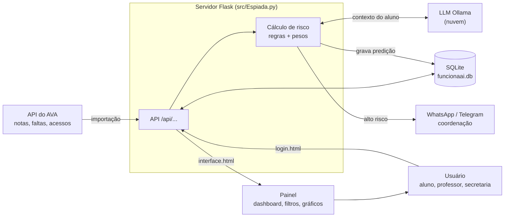
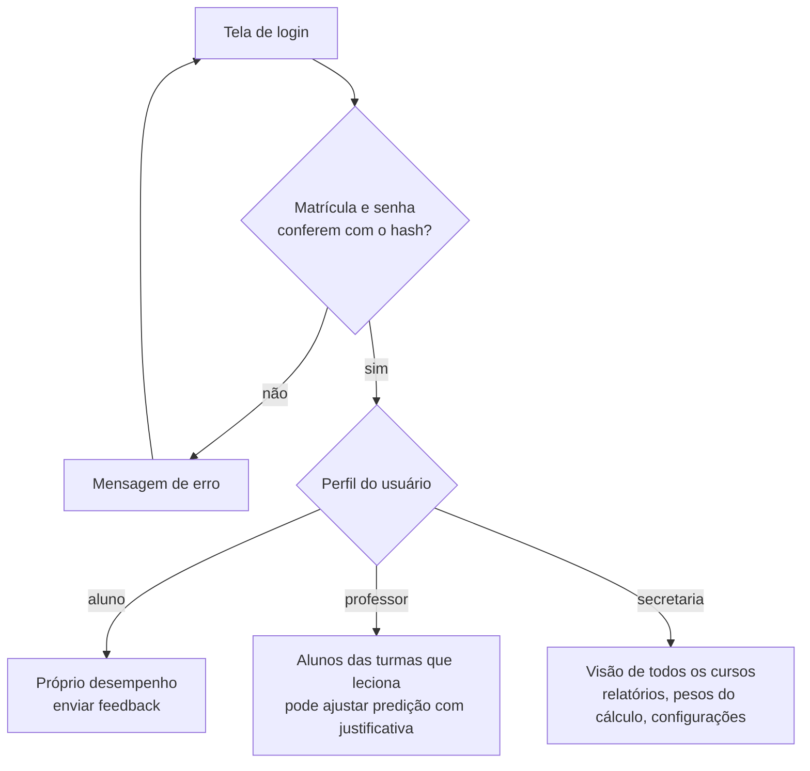
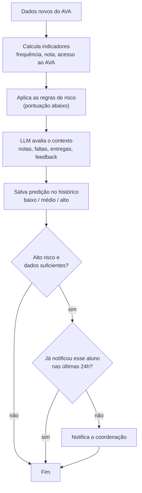
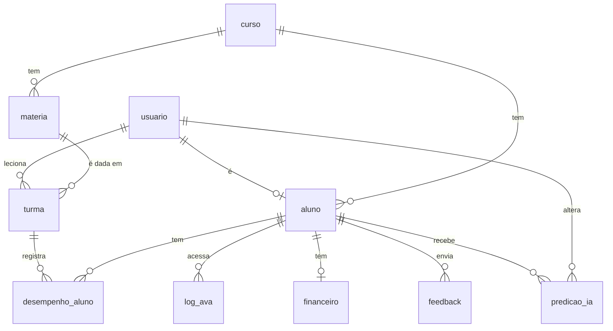

# Espiada — SIMPA

Sistema de monitoramento e predição de risco de evasão acadêmica. Flask + SQLite; servidor em `src/Espiada.py`.

## Tecnologias

| Parte | Tecnologia |
|---|---|
| Back-end | Python 3.10+ com Flask |
| Banco de dados | SQLite (`src/funcionaai.db`), tabelas em `src/schema.sql` |
| Front-end | HTML + CSS + JavaScript puro (`login.html`, `interface.html`) |
| Predição (semana 06) | LLM em nuvem do Ollama (≥ 7B parâmetros) |

## Banco de dados

As tabelas estão em [`src/schema.sql`](src/schema.sql) e são criadas sozinhas quando o servidor sobe.
Para recriar o banco do zero: apague `src/funcionaai.db` e rode o servidor de novo.

| Tabela | Guarda |
|---|---|
| `usuario` | login de aluno, professor e secretaria (matrícula é a chave, senha só em hash) |
| `curso`, `materia`, `turma` | estrutura acadêmica; a turma liga matéria + professor |
| `aluno` | dados do aluno (curso, período, situação, distância) |
| `desempenho_aluno` | notas (0 a 100) e faltas de cada aluno em cada turma |
| `log_ava` | cada acesso ao AVA |
| `financeiro` | mensalidades atrasadas |
| `feedback` | comentários do aluno sobre o curso ou a instituição |
| `predicao_ia` | histórico de predições de risco (baixo/médio/alto); alteração manual exige justificativa |

Para conferir as regras do banco: `python src/test_banco.py`

## API

Tudo fica em `/api/...`, é organizado por recurso e usa JSON na entrada e na saída (RNF02).
Para conferir as rotas: `python src/test_api.py`

**Padrão das respostas**

| Status | Quando | Corpo |
|---|---|---|
| `200` | consulta ou atualização ok | o registro ou a lista |
| `201` | criou algo | o registro criado, com o id |
| `400` | JSON inválido, faltou campo ou violou uma regra do banco (ex.: nota 101) | `{"erro": "..."}` |
| `404` | aluno ou recurso não existe | `{"erro": "..."}` |
| `409` | já existe (ex.: matrícula repetida) | `{"erro": "..."}` |

Um indicador sem dado ainda (ex.: aluno sem notas) vem como `null`.

**Rotas** (campos obrigatórios em **negrito**)

| Método | Rota | Corpo (entrada) | Resposta |
|---|---|---|---|
| GET | `/api/cursos` | — | lista de `{id_curso, nome_curso}` |
| POST | `/api/cursos` | **nome_curso** | o curso criado |
| GET | `/api/materias` | — | lista de `{id_materia, id_curso, nome_materia}` |
| POST | `/api/materias` | **id_curso**, **nome_materia** | a matéria criada |
| GET | `/api/turmas` | — | lista de `{id_turma, id_materia, matricula_professor, semestre}` |
| POST | `/api/turmas` | **id_materia**, **semestre**, matricula_professor | a turma criada |
| GET | `/api/alunos` | — | lista de resumos do aluno (abaixo) |
| GET | `/api/alunos/{matricula}` | — | resumo + `disciplinas` (notas e faltas por turma) |
| POST | `/api/alunos` | **matricula**, **nome**, **senha**, **id_curso**, **situacao**, email, periodo, data_ingresso, distancia_km | o resumo do aluno |
| PUT | `/api/alunos/{matricula}/desempenho` | **id_turma**, nota_cic1..3, media_final, total_aulas, faltas_totais, situacao_materia | o resumo atualizado |
| POST | `/api/alunos/{matricula}/ava` | **data_acesso**, **min_sessao** | o acesso registrado |
| POST | `/api/alunos/{matricula}/feedback` | **alvo** (`curso` ou `instituicao`), comentarios, avaliacao_curso (1–5) | o feedback registrado |
| POST | `/api/alunos/{matricula}/predicao` | — | `{matricula, risco, score, fatores}` e grava no histórico |
| GET | `/api/alunos/{matricula}/predicao` | — | histórico de predições, da mais nova para a mais antiga |

A senha é guardada só em hash e nunca volta nas respostas. O `PUT .../desempenho` é a porta de entrada da importação do AVA (semana 04); na semana 03 ele fica restrito ao importador, porque nota e falta não se editam à mão (RN11).

**Resumo do aluno** (`GET /api/alunos`, o que o painel usa):

```json
{
  "matricula": 2024001, "nome": "Ana", "curso": "Engenharia de Software", "turma": "Cálculo",
  "periodo": 2, "situacao": 1, "distancia": 40,
  "freq": 50.0, "nota": 50.0, "ava": 10.0, "reclamacoes": 1, "risco": "alto"
}
```

**Predição** (`POST /api/alunos/{matricula}/predicao`):

```json
{
  "matricula": 2024001, "risco": "alto", "score": 7,
  "fatores": [{"descricao": "Frequência abaixo de 75%", "negativo": true}]
}
```

**Erro:**

```json
{"erro": "campos obrigatórios: matricula, senha"}
```

## Como executar

Precisa do **Python 3.10+** instalado.

1. Baixe o projeto e entre na pasta:
   ```bash
   git clone https://github.com/diegounilalele/Projeto-SIMPA.git
   cd Projeto-SIMPA
   ```
2. (Opcional) Crie e ative um ambiente virtual:
   ```bash
   python -m venv .venv
   .venv\Scripts\activate        # Windows
   source .venv/bin/activate     # Linux/Mac
   ```
3. Instale as dependências:
   ```bash
   pip install -r requirements.txt
   ```
   A única dependência externa é o **Flask**, que já instala junto Werkzeug, Jinja2, MarkupSafe, ItsDangerous, Click e Blinker. O `sqlite3` já vem com o Python.
4. Rode o servidor:
   ```bash
   python src/Espiada.py
   ```
5. Abra http://127.0.0.1:5000 — abre a tela de login (`login.html`); ao clicar em **Acessar** vai para o painel (`interface.html`), que consome a API (`/api/...`).

Para parar o servidor: `Ctrl+C` no terminal.

## Fluxo do sistema

### Visão geral

Os dados acadêmicos vêm só do lyceum via webscraping (ninguém edita nota ou frequência à mão). O servidor guarda tudo no SQLite, calcula o risco de cada aluno, pede para a LLM avaliar o contexto e mostra o resultado no painel conforme o perfil de quem entrou.



### Login e perfis

Cada perfil vê só o que pode (RN09, RN10, CA01).



### Predição de risco

Roda sempre que chegam dados novos do AVA (RF10). Cada predição vira uma linha nova em `predicao_ia`, então o histórico do aluno nunca se perde.



### Modelo do banco



### Como os indicadores são calculados

- `freq` = 100 × (1 − faltas_totais / total_aulas)
- `nota` = media_final (0 a 100), ou média das notas de ciclo; média entre as disciplinas
- `ava` = soma de min_sessao / 600 min (limitado a 100%)
- `reclamacoes` = feedbacks com avaliação 1 ou 2
- `risco` (`calcular_risco()` em `src/Espiada.py`): freq < 75 (+2), nota < 60 (+2), ava < 50 (+1), reclamação (+1), distância > 30 km (+1); indicador sem dado não conta. ≥4 alto, ≥2 médio, senão baixo.
